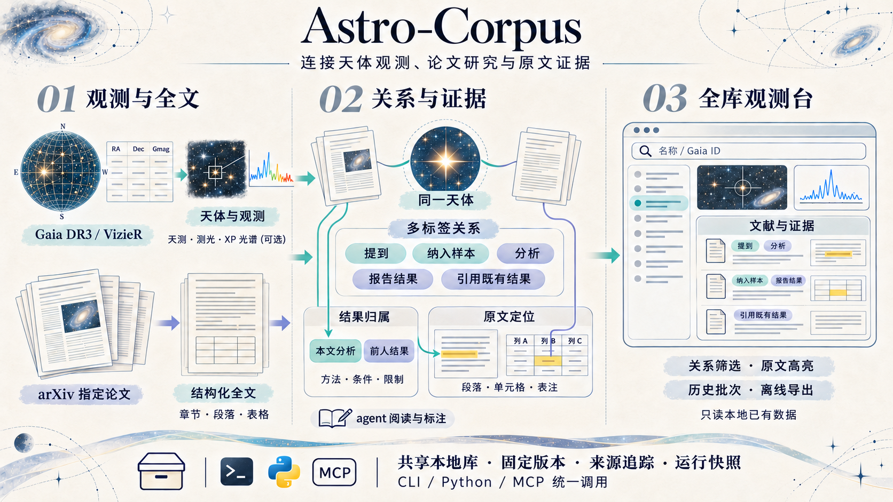

# Astro-Corpus

[](docs/images/astro-corpus-hero-evidence.png)

*项目总览：分别构建天体观测样本与论文全文，连接同一天体的多标签关系、带归属的结果及原文证据，在全库观测台筛选和高亮查看。共享本地库保留版本与历史；TWA 试点标注仍待复核。点击图片可查看大图。*

**以 Gaia 为主的天文数据与论文语料管线。** Python 包名为 `astro-pipeline`。

项目按需获取星表、Gaia XP 光谱和文献资料，保留来源、匹配结果及文件版本，
让同一套能力可以通过命令行、Python 或 AI agent 调用。
这里的 **corpus** 指一个选定样本及其观测、文献和运行记录的集合。
项目负责数据准备和检索接口，不训练基础模型，也不是现成的问答或 RAG 系统。

先了解原理可读 [技术概览](docs/technical-overview.md)；
安装和客户端接入见 [使用指南](docs/integration-guide.md)，版本历史见 [CHANGELOG](CHANGELOG.md)。

**[打开全库观测台在线示例 →](https://cetizhao.github.io/Astro-Corpus/)**
无需安装，展示 8 个 Gaia DR3 天体的固定数据快照。搜索 `TWA`，或直接查看默认选中的
`TWA 31`，浏览天体参数、论文关系与原文证据短摘录。本次示例未包含 XP 光谱文件。
示例仅包含少量公开数据，文献标注保留待复核状态，完整原文通过论文链接访问。

## 已实现的能力

- **Gaia DR3 星表**：按名称、坐标范围或用户星表获取天测与测光数据。
- **发表成员目录**：从 VizieR 搜索、预览并显式选择表，再匹配 Gaia；保留原表、未匹配行及重复样本。
- **Gaia XP 光谱**：显式下载可用的 Sampled / Continuous 产品，保存检查点和固定版本。
- **源—论文关联**：使用 SIMBAD 整理的书目，保存 bibcode、标题、DOI 和可解析的 arXiv ID。
- **论文全文**：显式获取 1–50 篇 arXiv 论文，保存原文件、结构化 JSON 和 Markdown。
- **关系与证据**：通过 MCP 保存多标签关系和带归属的成员判断；HTML 查看器展示论文卡片、历史批次及原文高亮，也可导出固定版本的离线页面。TWA 试点已扩展到 10 篇论文，全部保留待复核状态；见 [使用指南](docs/paper-evidence.md)。
- **共享本地库**：SQLite 管理元数据，不可变文件库复用观测与产品；每次构建保留自己的输入和运行快照。
- **查询与展示**：单个 corpus / 全库查询、静态概览页，以及集成星图、光谱和文献证据的只读全库观测台；支持名称、样本标签和 Gaia ID 搜索。
- **有界采集**：Gaia 主表分块、固定区域成员表采集和可恢复的下载任务。

Gaia DR3 是当前可运行基准。DR4 已有能力探测接口，但未确认的数据契约不会被猜测启用。
LAMOST / SDSS 适配仍保留，不是当前开发主线。

## 系统总览



图 1 区分两条独立的构建路径：星表样本及其可选产品、显式选择的论文全文。
AI agent 在管线外部选择工具；Python 代码负责实际获取、解析和保存。
关系标注读取固定版本的论文上下文，保存多标签关系、区分本文分析与前人工作的结果，
并校验原文位置后写入不可变批次。机器辅助标注仍需人工复核。
本机观测台只读共享库中的星图、光谱和文献证据；GitHub Pages 版复用相同界面，
读取独立选取的静态示例 JSON。页面操作不会触发远程数据下载。

图的 [Mermaid 源文件](docs/diagrams/system-overview.mmd) 可直接修改。
样本选择、全文读取的细节图及重新生成方式见 [架构说明](docs/architecture.md)。

## 快速开始

需要 Python **3.11+** 和 [uv](https://docs.astral.sh/uv/)。
以下示例从公开仓库的 `main` 安装当前功能。

```bash
git clone --branch main \
  https://github.com/cetizhao/Astro-Corpus.git astro-pipeline
cd astro-pipeline
uv sync --locked
uv run --locked pytest -q
uv run --locked python scripts/library.py status
```

测试默认排除联网测试；`library.py status` 只读本地状态，不创建不存在的数据库。
上述检查不查询天文服务，但首次安装依赖需要联网。

**新 clone 不带本地数据库。** `data/`、完整星表和个人凭据不随 Git 分发；
在线示例使用的少量公开数据单独保存在 `examples/observatory/`。
首次看到空库是正常结果，不必为了启动服务先下载完整样本。
旧 TWA 演示的准备和重建方法见 [TWA bootstrap](docs/operator-runbook.md#twa-demo-bootstrap)。

在线示例可用标准库独立构建，不需要安装管线依赖或准备数据库：

```bash
python scripts/build_pages.py
python -m http.server 8766 --directory dist/pages
```

然后打开 `http://localhost:8766/`。更新示例数据或观测台资产并推送到 `main` 后，
GitHub Actions 会自动重新发布 Pages；只上传 `dist/pages` 中的静态站点文件。

## 按任务选择入口

### 查本地已有数据

```bash
uv run --locked python scripts/library.py status
uv run --locked python scripts/library.py serve
```

查看器地址为 `http://127.0.0.1:8765/`，只监听本机。
没有现有数据时会显示空状态。配置、缓存、导出和备份见 [共享库说明](docs/library.md)。

Python 也可以直接使用全库的只读接口：

```python
from astro_pipeline.library import get_library
from astro_pipeline.library.query import Library

library = Library(get_library(create=False))
result = library.lookup_source("5401795662560500352", release="dr3")
```

这里不自动下载缺失数据。单个 corpus 的 `source` / `paper` / `summary` 查询例子见
[直接 CLI 与 Python 查询](docs/integration-guide.md#direct-cli-and-python-queries)。

### 获取小范围 Gaia 场源（联网）

```bash
uv run --locked python scripts/build_corpus.py \
  --cone 84 -5 0.2 --limit 10 \
  --label orion_field --out-dir data/orion_field --skip-simbad
```

坐标和半径单位均为度。这会查询 Gaia 并写入本地数据；`--skip-simbad` 只跳过书目阶段。
锥形搜索选出的是几何范围内的场源，**不能直接称作 Orion 成员**。
更多输入方式见 [输入语义](docs/architecture.md#input-semantics)。

### 获取星团或协会的发表成员

使用 MCP 或 Python 的三步流程：

1. `search_membership_catalogs`：寻找发表目录。
2. `preview_membership_catalog`：检查表、列、正式成员与候选成员的区别。
3. `download_membership_corpus`：显式选表，保留原始样本定义并匹配 Gaia。

不能用 `region="Taurus"` 的场源搜索代替成员选择。
完整参数见 [成员目录工作流](docs/integration-guide.md#membership-workflow)；
CrA / Upper Sco 的固定采集与验收记录见 [运维手册](docs/operator-runbook.md#fixed-cra-and-upper-sco-acquisition)。

### 构建论文全文语料（联网）

先把显式论文列表保存为 `data/papers.json`，例如：

```json
["2305.03557", "1801.03938"]
```

```bash
uv run --locked python scripts/library.py paper-build paper_demo \
  --selection data/papers.json
uv run --locked python scripts/library.py paper-status paper_demo
```

全文读取优先 HTML，再尝试 LaTeX 源文件和 PDF 文本回退；默认另存同版本 PDF 供核查。
同一请求重跑复用固定检查点，`--refresh` 才创建新 run。
`partial` 表示已保存可用内容但存在解析或获取限制，**不等于没有全文，也不等于科学核验通过**。
这种结果的 CLI 退出码为 3。范围、许可、清洗和测试说明见 [论文语料指南](docs/paper-corpus.md)。

### 让 AI agent 调用

仓库提供 `.mcp.json` 和 `.codex/config.toml`，使用 MCP（Model Context Protocol）
把相同 Python 能力暴露为结构化工具。客户端需要信任项目并启动对应服务：

```bash
uv run --locked python -m astro_pipeline.mcp_server
```

正常使用时服务由 MCP 客户端启动；单独运行这个命令是在等待协议消息，不是聊天界面。
目前有 30 个工具，包含全库查询、成员目录、数据下载、进度检查及天体—论文证据读写。
客户端配置、跨项目复用和完整工具表见 [接入指南](docs/integration-guide.md)。

## 数据与使用边界

- **样本定义**：保留目录概率、分组、标志、匹配结果和重复输入，不静默应用科学质量筛选。
- **身份与版本**：Gaia 身份是 `(release, source_id)`；论文固定具体 arXiv 版本，运行固定制品版本。
- **覆盖范围**：本地库不是完整天球索引，新的天区或位置匹配仍需要查询 Gaia。
- **文献证据**：SIMBAD 书目关联不等于全文已下载，更不等于某个段落已经被确认描述该天体。
- **解析质量**：全文处理是保守的格式解析，不做 OCR、模型改写或科学参数自动核验。
- **许可与凭据**：可公开读取不等于允许训练或再分发。个人凭据只放在 gitignored 的
  `config/local.yaml` 或环境变量中，不提交到 Git。
- **当前未实现**：完整跨巡天融合、统一科学特征提取、向量检索和模型训练。

默认持久数据分为元数据索引 `data/_library/index.sqlite3`、不可变文件对象和各 corpus 的
`runs/<run_id>/` 快照。`manifest.json` 记录进度、错误与版本；看到已发布 run 不代表全部
可选阶段都已完成。JSONL 是简化导出，每个样本行一条记录，不删除重复同星输入。

## 文档导航

| 要解决的问题 | 文档 |
|---|---|
| 第一次安装、CLI/Python/MCP 使用 | [使用与接入](docs/integration-guide.md) |
| 入口、模块、数据流、可编辑架构图与字段契约 | [系统架构](docs/architecture.md) |
| 共享库路径、缓存、版本、导出与备份 | [共享库说明](docs/library.md) |
| 论文获取、读取、清洗、许可与恢复 | [论文语料指南](docs/paper-corpus.md) |
| 重建演示、固定样本采集、验收和排障 | [运维手册](docs/operator-runbook.md) |
| 技术栈、存储概念和部署边界 | [技术概览](docs/technical-overview.md) |
| Python 工程与语料管线学习 | [学习指南](docs/learning-guide.md) |
| DR4 哪些已知、哪些必须现场确认 | [DR4 准备情况](docs/dr4-readiness.md) |
| 历史变更 | [CHANGELOG](CHANGELOG.md) |

已完成的区域采集与 30 篇论文试点是带日期的本地验收记录，不表示数据随仓库分发，
也不代替使用者对样本定义、位置匹配和科学内容的独立核查。
