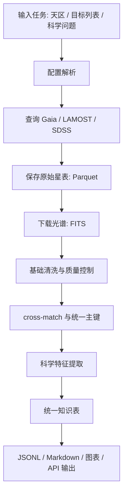

# astro-pipeline 详细说明

> **版本 0.2.1（2026-06-28）** — v0.2 双向「源 ↔ 论文」查询 API 之上新增 arxiv_id
> 反向解析（76% 覆盖率，修复 `corpus paper <arxiv_id>` 路径）和交互式 corpus 可视化
> （`astro_pipeline.viz`）；按当前阶段需求，开发主线收窄至 **Gaia + arXiv**，LAMOST/SDSS
> 适配保留可用但暂不投入新开发。详见 [CHANGELOG.md](CHANGELOG.md)。

---

本文档说明 `astro-pipeline` 的设计目标、当前实现、数据流、模块职责、可运行演示方式，以及后续要补齐的清洗、cross-match、科学分析与结构化输出层。它面向两类读者：

- **开发者**：知道代码在哪里、每一步做什么、怎么扩展。
- **下游使用者**：理解这个 pipeline 能把公开天文数据库转成统一、可复用、可被 AI 调用的数据接口。

## 1. 项目定位

`astro-pipeline` 的现实目标不是训练基础模型，而是先建立一套可自动运行的天文数据准备管线：

```text
公开天文数据库
  -> 按需查询与下载
  -> 格式统一
  -> 质量控制
  -> cross-match
  -> 科学分析/特征提取
  -> 结构化输出
  -> 供检索、训练、知识库或 agent skill 调用
```

当前策略是 **pipeline 优先、按需获取、演示可跑通**。不需要把 Gaia、LAMOST、SDSS 的全量数据下载到本地；先把接口、数据模型、下载机制和小样本验证打通，后续根据下游消费者的具体格式要求再适配输出。

## 2. 当前实现状态

当前代码已经实现了一个多数据源的最小可用框架。**v0.2.1 起开发主线收窄至 Gaia + arXiv**——LAMOST/SDSS 适配仍可调用、corpus 查询里继续以降级方式返回（`status="unavailable"`），但不在近期开发计划内。

| 能力 | 状态 | 说明 |
|---|---|---|
| Gaia DR3 星表查询 | 已实现 | 通过 `astroquery.gaia` 和 ADQL 查询 `gaiadr3.gaia_source` |
| Gaia XP 光谱源筛选 | 已实现 | 筛选 `has_xp_sampled = true` |
| Gaia XP 光谱下载 | 已实现 | 通过 Gaia DataLink 获取 BP/RP sampled spectra 的 FITS |
| LAMOST DR11 星表查询 | 已实现 · 暂缓 | 通过 VizieR 查询 LRS 星表；v0.2.1 起不在主线 |
| LAMOST 光谱下载 | 已实现 · 暂缓 | 按 `obsid` 下载 FITS；v0.2.1 起不在主线 |
| SDSS DR17 星表查询 | 已实现 · 暂缓 | 通过 `astroquery.sdss` 查询 PhotoObj 与 SpecObj JOIN |
| SDSS 光谱下载 | 已实现 · 暂缓 | 按 `plate/mjd/fiberid` 下载 FITS |
| 统一查询对象 | 已实现 | `ConeSearchQuery` 与 `ParameterQuery` |
| 统一返回对象 | 已实现 | `CatalogResult` 与 `SpectrumResult` |
| Parquet/FITS 输出 | 已实现 | 星表默认保存为 Parquet，可支持 FITS |
| 下载断点续传 | 已实现 | `DownloadCheckpoint` 记录 completed/failed |
| 网络重试 | 已实现 | `tenacity` 指数退避重试 |
| 双向「源↔论文」语料库 API | 已实现 | `astro_pipeline.corpus`：源→论文 + 论文→源，SIMBAD 权威书目 |
| arxiv_id 反向解析 | 已实现 | DOI→arXiv 批量 API，76% 覆盖（v0.2.1 修复） |
| corpus 可视化 | 已实现 | `astro_pipeline.viz`：6 张概览图 + 搜索/点击 focus |
| cross-match 引擎 | 未实现 | 当前只有各数据源独立查询/下载 |
| 质量控制模块 | 未实现 | 质量过滤目前散落在查询条件或文档建议中 |
| 光谱分析模块 | 未实现 | 尚未提取等值宽度、S/N、恒星参数等统一特征 |
| 大模型 JSON/文本输出 | 未实现 | 待下游 schema 约定明确后再固化 |

## 3. 数据源选择

当前 pipeline 以 Gaia、LAMOST、SDSS 为第一批数据源。

| 数据源 | 代码配置版本 | 核心价值 | 当前接入方式 |
|---|---:|---|---|
| Gaia | DR3 | 全天高精度天测、测光、BP/RP 低分辨率光谱、部分 RVS | Gaia Archive TAP/ADQL + DataLink |
| LAMOST | DR11 v2.0 | 北天大规模低/中分辨率光谱，恒星参数、视向速度、金属丰度 | VizieR 星表 + LAMOST FITS 下载 |
| SDSS | DR17 | 光学测光、星系/类星体/恒星光谱，APOGEE 近红外高分辨恒星光谱 | SDSS SkyServer/SAS via astroquery |

补充说明：

- Gaia DR3 是当前代码的稳定基准；Gaia DR4 预计在 2026 年底前后发布，代码通过 `db_schema` 预留了切换版本的入口。
- LAMOST DR11 v2.0 已在 2025 年面向全球发布，当前配置使用 DR11 的公开地址和 VizieR 星表编号。
- SDSS 代码使用 DR17，因为它是 SDSS-IV 的最终完整发布，接口成熟；SDSS-V 已有更新公开版本，后续可作为新 `SdssSource` 配置或新 source 扩展。

参考入口：

- Gaia Archive: https://gea.esac.esa.int/archive/
- LAMOST DR11 v2.0: https://lamost.org/dr11/v2.0/
- SDSS DR17: https://www.sdss4.org/dr17/

## 4. 代码结构

```text
astro-pipeline/
  config/
    default.yaml            # 默认配置
    benchmark.yaml          # 小样本 benchmark 配置
  src/astro_pipeline/
    config.py               # Pydantic 配置模型
    retry.py                # 网络重试策略
    corpus.py               # 【v0.2】双向「源↔论文」查询 API + CLI
    models/
      query.py              # 查询输入模型
      results.py            # 查询/下载返回模型
      paper.py              # 论文边表 + arxiv/bibcode 列装配
    io/
      writer.py             # Parquet/FITS 输出与 checkpoint
      exporter.py           # 知识表构建（多模态标志 + 论文列）
    crossmatch/             # cross-match 引擎（Gaia id / 位置）
    sources/
      base.py               # 数据源抽象基类
      gaia.py               # Gaia DR3 适配器
      lamost.py             # LAMOST DR11 适配器
      sdss.py               # SDSS DR17 适配器
      external.py           # 外部星表（如 TWAxgdr3.csv）加载
      simbad_refs.py        # 【v0.2】SIMBAD 权威书目 -> 论文边
      arxiv_search.py       # arXiv 关键词检索（仅用于发现，不作归属）
    viz/                    # 【v0.2.1】交互式 corpus 可视化
      source_paper.py       #   源↔论文 HTML 概览生成器（6 张图 + focus）
  scripts/
    build_twa_paper_edges.py # 【v0.2】重建 TWA 论文边表（两阶段、可续跑）
    resolve_arxiv_ids.py    # 【v0.2.1】批量 arXiv DOI -> arxiv_id 反查（~11 min/3k 篇）
    build_viz.py            # 【v0.2.1】重生成 data/twa/source_paper_viz.html
    export_jsonl.py         # 【v0.2.1】corpus → 简化 schema JSONL 导出
  examples/
    twa_sample.py           # TWA 端到端 demo（SIMBAD 关联 + 正确标志）
  tests/
    test_gaia.py            # Gaia 小样本查询测试
    test_lamost.py          # LAMOST 小样本查询测试
    test_sdss.py            # SDSS 小样本查询测试
    test_exporter_idcol.py  # 【v0.2】多模态 id 列回归测试
    test_bibcode_to_arxiv.py# 【v0.2】bibcode 解析测试
    test_corpus_offline.py  # 【v0.2】双向查询离线测试
    test_paper_edges.py     # 【v0.2】论文边结构 + 过匹配防护测试
    benchmark.py            # 多数据源、多模态下载验证脚本
```

## 5. 核心数据模型

### 5.1 查询输入

`ConeSearchQuery` 表示天区锥形搜索：

| 字段 | 含义 |
|---|---|
| `ra` | 赤经，单位 deg |
| `dec` | 赤纬，单位 deg |
| `radius_deg` | 搜索半径，单位 deg |
| `extra_conditions` | 额外过滤条件，如 `phot_g_mean_mag_max` |
| `limit` | 返回行数上限 |

`ParameterQuery` 表示按字段条件搜索：

| 字段 | 含义 |
|---|---|
| `conditions` | 形如 `{column: (operator, value)}` 的过滤条件 |
| `limit` | 返回行数上限 |
| `order_by` | 排序字段 |

目前 Gaia 支持 cone search 和 parameter query；SDSS 支持二者（v0.2 已修复 `ParameterQuery` 的 `{limit}` SQL 模板缺陷）；LAMOST 当前只支持 cone search。

### 5.2 返回对象

`CatalogResult` 统一封装星表查询结果：

| 字段 | 含义 |
|---|---|
| `source_name` | 数据源名称 |
| `data` | `pandas.DataFrame` |
| `row_count` | 返回行数 |
| `query_description` | ADQL/SQL 或查询描述 |
| `output_path` | 保存到本地的文件路径 |

`SpectrumResult` 统一封装光谱下载结果：

| 字段 | 含义 |
|---|---|
| `source_id` | 源 ID 或光谱 ID |
| `path` | 本地 FITS 路径 |
| `success` | 下载是否成功 |
| `error` | 失败原因 |

## 6. Pipeline 分层说明

### 6.1 配置层

配置入口在 `config/default.yaml` 与 `config/benchmark.yaml`。

主要配置分为四组：

| 配置段 | 作用 |
|---|---|
| `output` | 本地数据目录：星表、光谱、checkpoint |
| `network` | 超时、重试次数、指数退避间隔、下载 chunk size |
| `gaia` | Gaia TAP 地址、schema、默认字段、账号密码 |
| `lamost` | LAMOST DR11 地址、光谱下载地址、VizieR 星表编号 |
| `sdss` | SDSS SkyServer/SAS 地址、data release |

当前默认输出目录：

```text
data/
  catalogs/       # Parquet 星表
  spectra/        # FITS 光谱
  checkpoints/    # 预留目录；实际 checkpoint 当前放在各 spectra 子目录
```

### 6.2 数据源抽象层

所有数据源都继承 `CatalogSource`，必须实现三个方法：

| 方法 | 作用 |
|---|---|
| `get_source_name()` | 返回人类可读的数据源名称 |
| `query_catalog(query, output_path)` | 查询星表并可选保存 |
| `download_spectra(identifiers, output_dir, resume=True)` | 下载光谱，支持断点续传 |

这个抽象让上层 workflow 不必关心 Gaia、LAMOST、SDSS 各自的 API 差异，只需要知道：

```python
source.query_catalog(query, output_path)
source.download_spectra(ids_or_dataframe, output_dir)
```

### 6.3 查询层

查询层负责把统一的 query object 转成各数据库能理解的语言。

Gaia：

- 将 `ConeSearchQuery` 转换为 ADQL 的 `CONTAINS(POINT, CIRCLE)`。
- 将 `ParameterQuery` 转换为 ADQL 的 `WHERE column op value`。
- 默认查询字段包括 `source_id`、`ra`、`dec`、`parallax`、`pmra`、`pmdec`、`phot_g_mean_mag`、`radial_velocity`、`ruwe` 等。
- `query_xp_sources()` 会额外筛选 `has_xp_sampled = true`。

LAMOST：

- 使用 `astroquery.vizier.Vizier.query_region()` 做 cone search。
- 默认查询 LRS 星表 `V/162/dr11l`。
- 返回后将列名统一转为小写，并处理 VizieR 可能产生的重复列名。

SDSS：

- cone search 当前实现为 RA/Dec 矩形近似筛选，再 JOIN `PhotoObj` 与 `SpecObj`。
- 返回字段包括 `ra`、`dec`、`objid`、`specobjid`、`plate`、`mjd`、`fiberID`。
- 查询结果列名统一转为小写。

### 6.4 下载层

下载层负责把星表中的 ID 转换成实际 FITS 文件。

Gaia XP 光谱：

1. 输入 `source_id` 列表或包含 `source_id` 的 DataFrame。
2. 每 5000 个源分批调用 `Gaia.load_data()`。
3. retrieval type 使用 `XP_SAMPLED`。
4. 保存为 `gaia_xp_{source_id}.fits`。
5. 记录 checkpoint。

LAMOST 光谱：

1. 输入 `obsid` 列表或包含 `obsid` 的 DataFrame。
2. 拼接 `spectrum_base_url + obsid`。
3. 保存为 `lamost_spec_{obsid}.fits`。
4. 记录 checkpoint。

SDSS 光谱：

1. 输入必须是包含 `plate`、`mjd`、`fiberid` 的 DataFrame。
2. 调用 `SDSS.get_spectra(plate, mjd, fiberID)`。
3. 保存为 `sdss_spec_{plate}-{mjd}-{fiberid}.fits`。
4. 记录 checkpoint。

### 6.5 输出层

当前输出分为两类：

| 数据 | 当前格式 | 用途 |
|---|---|---|
| 星表 | Parquet | 结构化表格，适合后续 pandas/pyarrow 处理 |
| 光谱 | FITS | 保留天文标准格式、header 和多 HDU 结构 |

`io/writer.py` 也提供了 `save_catalog_fits()`，可将 DataFrame 转为 FITS 表。

后续面向下游消费或大模型训练的输出建议增加三层：

| 输出层 | 建议格式 | 说明 |
|---|---|---|
| 机器可读主表 | Parquet/Arrow | 大规模中间数据，保留列类型 |
| Agent/API 输出 | JSON Lines | 每个天体或每条光谱一条 JSON，适合 RAG/检索 |
| 人类可读报告 | Markdown/HTML/PDF | 用于演示、审核与论文草稿 |

## 7. 当前 benchmark 演示流程

`tests/benchmark.py` 是当前最接近完整 demo 的脚本。它验证六个模态：

| 模态 | 操作 |
|---|---|
| Gaia DR3 / Astrometry | 查询 Kepler 天区附近 Gaia 星表 |
| Gaia DR3 / XP Spectra | 筛选有 XP 光谱的源并下载少量 FITS |
| LAMOST DR11 / LRS Catalog | 查询 Kepler 天区附近 LAMOST LRS 星表 |
| LAMOST DR11 / LRS Spectra | 下载少量 LAMOST 光谱 FITS |
| SDSS DR17 / SpecObj | 查询 SDSS 覆盖天区中的测光-光谱 JOIN |
| SDSS DR17 / Spectra | 下载少量 SDSS 光谱 FITS |

运行方式：

```bash
cd /path/to/astro-pipeline
uv run python tests/benchmark.py
```

如需要 Gaia 账号，可设置环境变量：

```bash
export GAIA_USERNAME="your_username"
export GAIA_PASSWORD="your_password"
uv run python tests/benchmark.py
```

脚本会输出一个 Rich table，展示每个模态的星表行数、文件有效性、光谱下载数量、耗时和 PASS/PARTIAL/FAIL 状态。

## 7.5 双向「源 ↔ 论文」语料库查询（v0.2 核心 demo）

这是本项目当前的核心交付：输入一个 TWA 源，得到它对应的论文（id / title /
链接）以及该源的多模态数据（Gaia / LAMOST / SDSS）；输入一篇论文，得到它研究的源
列表以及每个源的多模态数据。

### 论文关联方式（权威，非子串匹配）

论文关联来自 **SIMBAD 的权威书目**：SIMBAD 为每个天体维护一个经过人工/算法整理的参
考文献表，每一条 bibcode 都是真正研究过该源的论文。流程：

```text
Gaia DR3 source_id
  -> SIMBAD query_object("Gaia DR3 <id>") 得到该源的参考文献 bibcode 列表
  -> bibcode -> arXiv id（arXiv 预印本 bibcode 直接解析；期刊论文用 arXiv DOI API 反查）
  -> bibcode -> title / DOI / year / journal（SIMBAD query_bibcode）
```

这替换了 v0.1 的子串匹配（曾把 94 篇论文匹配到全部 49 个源，是垃圾结果）。结果缓存到
`data/twa/simbad_refs.parquet`，可断点续跑、离线复用。

### 命令行使用

```bash
# 查询一个源：多模态数据 + 论文列表（带 arxiv id / bibcode / title / url）
python -m astro_pipeline.corpus source 5412403269717562240
python -m astro_pipeline.corpus source 5412403269717562240 --offline --json

# 反向查询一篇论文：它研究的源列表 + 每个源的多模态数据
python -m astro_pipeline.corpus paper 1806.05059                 # 按 arxiv id
python -m astro_pipeline.corpus paper "2018A&A...620A.172Z"      # 按 bibcode
python -m astro_pipeline.corpus paper "Census of the TW Hya"     # 按 title 子串

# 语料覆盖概览
python -m astro_pipeline.corpus summary
```

### Python API

```python
from astro_pipeline.corpus import Corpus

corpus = Corpus(data_dir="data/twa", catalog_path="TWAxgdr3.csv", offline=False)

# 源 -> 多模态 + 论文
res = corpus.lookup_source("5412403269717562240")
# res["multimodal"]["gaia_xp"] | ["lamost"] | ["sdss"]  -> {available, status, rows, data}
# res["papers"] -> [{arxiv_id, bibcode, title, year, journal, doi, url}, ...]

# 论文 -> 源
res = corpus.lookup_paper("1806.05059")
# res["paper"]  -> 论文元数据
# res["sources"] -> [{gaia_id, astrometry, multimodal}, ...]
```

### 多模态数据策略

- **Live + cached fallback**：优先实时查询 Gaia/LAMOST/SDSS；失败时回退到 `data/twa`
  缓存，保证 demo 永远有结果。`--offline` 仅用缓存。
- **优雅降级**：单个巡天失败不会让整体查询崩溃，该模态返回
  `status="unavailable"`/`"not_in_catalog"`。
- **诚实**：若一个源确实没有某巡天数据（例如 TWA 多数成员不在 LAMOST/SDSS 覆盖内），
  对应标志如实为 `False`，而不是像 v0.1 那样全部误报 `False`。

### 重新生成 TWA 演示数据

```bash
# 阶段一（可靠、较快）：SIMBAD 源->bibcode + bibcode 元数据（title/DOI/year）
python scripts/build_twa_paper_edges.py

# 阶段二（推荐）：批量反查 arxiv_id
# 用 arXiv DOI API 的 boolean-OR 批量查询（~20 DOI/请求），3k 篇 ~11 分钟
# 幂等、可续跑，自动备份 paper_edges.parquet + simbad_refs.parquet
python scripts/resolve_arxiv_ids.py

# （legacy）阶段二旧路径：build_twa_paper_edges.py --resolve-arxiv
# 走单 DOI 串行查询 + SIMBAD 重查，~2.6 h/3k 篇，已被 resolve_arxiv_ids.py 取代
```

## 7.6 corpus 可视化（v0.2.1）

`astro_pipeline.viz.build_overview_html` 把 corpus 数据渲染成一个独立的 HTML
页面（默认 `data/twa/source_paper_viz.html`），完全离线、可邮件附件分发。

**包含 6 张概览图**：天空分布散点（颜色 = log 论文数）、Top 15 源 × 论文数、
Top 15 论文 × 覆盖源数、arXiv 覆盖率环形、论文年份分布、源-论文二分网络子图。

**两种 focus 方式**：

- 搜索框：输入 Gaia `source_id`（支持 `Gaia DR3 X` 前缀）→ 该源的论文列表；或
  输入 `arxiv_id` / `bibcode` / 唯一 title 子串 → 该论文的源列表。
- 点击交互：在天空图、横条图、二分图上点击任意节点 → focus 面板同步刷新。

**重新生成**：

```bash
python scripts/build_viz.py
```

读取 `paper_edges.parquet` + `TWAxgdr3.csv`，写出 HTML（一次性备份旧版到
`.bak`）。ECharts 库本地vendored 在 `data/twa/echarts.min.js`，所有数据以
JSON 内嵌，不依赖任何外部服务。


TWA 67 个成员中，部分源本身在 LAMOST/SDSS 没有光谱覆盖（演示如实反映）；少数源在
SIMBAD 没有条目或没有论文引用（结果如实返回空列表），不会伪造关联。

## 8. 建议的完整科学数据流


当前代码完成了"获取"和"原始保存"。面向下游消费，完整 pipeline 应扩展为：



### 8.1 输入任务

建议支持三种入口：

| 入口 | 示例 |
|---|---|
| 天区搜索 | 给定 RA/Dec/radius，查询一个星团或恒星形成区 |
| 目标列表 | 给定 Gaia source_id、LAMOST obsid 或 SDSS plate/mjd/fiber |
| 科学样本条件 | 例如 `G < 15`、`ruwe < 1.4`、`snrg > 10` |

### 8.2 基础清洗

建议新增 `cleaning/` 模块，将不同数据源的质量过滤固化为函数，而不是散落在查询参数里。

Gaia 推荐质量控制：

| 条件 | 作用 |
|---|---|
| `ruwe < 1.4` | 保证天测解可靠 |
| `parallax_over_error > 5` | 控制距离/视差信噪比 |
| `phot_g_mean_mag` 合理范围 | 避免过亮/过暗极端源 |
| BP/RP excess factor 过滤 | 控制测光质量 |
| 视差零点改正 | 后续科学分析必须做 |

LAMOST 推荐质量控制：

| 条件 | 作用 |
|---|---|
| `snrg > 10` 或按科学目标设定 S/N | 控制光谱质量 |
| `fibermask == 0` | 排除问题光纤 |
| `z != -9999` | 排除无效红移 |
| `with_norm_flux == 1` | 确认是否有归一化光谱 |
| 检查 `ANDMASK/ORMASK` | 排除坏像素 |

SDSS 推荐质量控制：

| 条件 | 作用 |
|---|---|
| `clean = 1` | 使用科学级测光 |
| `zWarning = 0` | 使用可靠红移 |
| 按 `class` 区分 STAR/GALAXY/QSO | 避免混合样本 |
| 检查 plate/mjd/fiber 唯一性 | 下载光谱时避免重复 |

### 8.3 Cross-match

cross-match 是本类项目最有价值的部分，因为它把"一个天体在不同巡天中的信息"合并成统一知识单元。

建议统一主键优先级：

```text
Gaia source_id
  > LAMOST gaia_source_id
  > SDSS 与 Gaia 的位置匹配结果
  > 源坐标哈希 uid
```

推荐方案：

| 匹配对象 | 推荐方法 | 说明 |
|---|---|---|
| Gaia × LAMOST | 优先用 LAMOST `gaia_source_id` | DR11 星表已包含 Gaia DR3 交叉字段 |
| Gaia × SDSS DR13 | Gaia Archive 内置 cross-match | 可直接 ADQL JOIN |
| Gaia × SDSS DR17 | 自行位置匹配或 CDS XMatch | Gaia 内置的是 DR13，不是 DR17 |
| 多源泛化匹配 | `astropy.coordinates.SkyCoord.match_to_catalog_sky()` | 小样本和 demo 足够 |

建议新增 `crossmatch/` 模块：

```text
crossmatch/
  gaia_lamost.py       # 用 gaia_source_id JOIN
  gaia_sdss.py         # 位置匹配或外部 xmatch
  generic.py           # SkyCoord 最近邻匹配
```

### 8.4 科学分析与特征提取

建议先实现“足够能演示、也能服务论文方向”的轻量分析。

| 模块 | 输入 | 输出 |
|---|---|---|
| 光谱基础统计 | FITS 光谱 | 波长范围、S/N、中位流量、坏像素比例 |
| Gaia HR 图参数 | Gaia 测光 + 视差 | 绝对星等、BP-RP 颜色 |
| 运动学 | Gaia 自行/视差/RV | 距离、切向速度、6D 相空间子集 |
| LAMOST 恒星参数 | LAMOST 星表 | Teff/logg/[Fe/H]/RV 统一字段 |
| 青年恒星特征 | LAMOST/SDSS 光谱 | Hα 等值宽度、Li 线、红外 excess 接口预留 |

与青年恒星 / 恒星形成研究方向最自然的 demo 题目：

```text
给定一个恒星形成区或年轻星团天区
  -> Gaia 查询候选成员
  -> LAMOST/SDSS 匹配光谱
  -> 提取运动学、HR 图位置、Hα 活动指标
  -> 输出年轻恒星候选知识表
```

这比泛泛做"全宇宙数据库"更容易形成可展示的科学故事。

### 8.5 大模型/知识库输出（JSONL）

`scripts/export_jsonl.py` 已实现一个**简化 schema** 的 JSONL 导出（每行一个 Gaia 源）。下游 schema 约定明确后会在 `to_record()` 适配层里调整，不影响上游。

**当前 schema**（v0.2.1 实现，对应 `data/twa/twa_corpus.jsonl`）：

```json
{
  "gaia_id": "5401795662560500352",
  "ra_deg": 165.4659,
  "dec_deg": -34.7048,
  "parallax_mas": 16.629,
  "parallax_error_mas": 0.015,
  "ruwe": 1.175,
  "g_mag": 10.451,
  "pm_ra_masyr": -68.31,
  "pm_dec_masyr": -13.90,
  "multimodal": {
    "gaia_xp": true,
    "lamost": false,
    "sdss": false
  },
  "papers": [
    {"arxiv_id": "2305.03557", "bibcode": "2023AJ....165..269L",
     "title": "A Census of the TW Hya Association with Gaia.",
     "year": 2023, "url": "https://arxiv.org/abs/2305.03557"}
  ],
  "n_papers": 2154,
  "provenance": {"pipeline_version": "0.2.1"}
}
```

**计划扩展**（待下游 spec 确认后再加）：

- 测光：BP/RP 星等（数据已在 catalog，未导出）
- 恒星参数：Teff / logg / [Fe/H]（Gaia DU 译文已存）
- 视向速度：`RV_gdr3` / `e_RV_gdr3`
- 质量标志：`astrometry_ok`（RUWE<1.4 等）、`photometry_ok`
- 谱数据路径：`spectra: {gaia_xp: "path.fits", ...}`（避免 base64 内联膨胀）

这个结构的核心原则：

- 保留 provenance，确保每个字段能追溯到数据源。
- 区分 missing value 和 false，避免模型误解。
- 字段名使用清晰单位后缀，如 `_deg`、`_mas`、`_kms`。
- 大表仍然用 Parquet 保存，JSONL 只作为导出层。

## 9. 已知技术问题

v0.2 已修复其中数项（见下表「状态」列）。剩余项为后续改进方向。

| 问题 | 位置 | 影响 | 状态 / 建议 |
|---|---|---|---|
| SDSS `ParameterQuery` SQL 模板未格式化 `{limit}` | `sources/sdss.py` | 参数查询会生成非法 SQL | ✅ v0.2 已修复（f-string） |
| SDSS 返回 HTML 错误页被当作星表缓存 | `sources/sdss.py` | 缓存污染、`<html>` 列 | ✅ v0.2 已修复（HTML 检测 + 抛错） |
| 多模态 `has_*` 标志全部为 False（id 列误判） | `io/exporter.py` | 知识表可用性失真 | ✅ v0.2 已修复（显式 per-survey Gaia 列） |
| 论文子串匹配产生 94×49 垃圾关联 | `sources/arxiv_search.py` | 论文关联完全不可信 | ✅ v0.2 已替换为 SIMBAD 权威书目 |
| `corpus paper <arxiv_id>` 查不到论文 | `paper_edges.parquet` 的 `arxiv_id` 列 | arxiv_id 全空，按 arxiv id 查询路径死的 | ✅ v0.2.1 已修复（`resolve_arxiv_ids.py` 反查，76% 覆盖） |
| Gaia 查询后若异常，`Gaia.ROW_LIMIT` 可能无法恢复 | `sources/gaia.py` | 后续查询可能继承错误 limit | 用 `try/finally` 恢复 |
| LAMOST 只接 LRS | `sources/lamost.py` | MRS 暂不能查询/下载 | 增加 `mode=lrs/mrs` 或独立 source |
| 光谱下载 URL 规则需实测 | `sources/lamost.py` | 直接 `base_url + obsid` 可能不适配所有文件 | 用官方下载接口或星表中的文件路径字段 |
| 实时查询依赖外网 | `sources/*` | CI/离线环境不稳定 | corpus 已支持 cache fallback；单测已离线化 |

## 10. 下一步开发建议

建议按"能展示、能解释、能扩展"的顺序推进。**v0.2.1 起主线聚焦 Gaia + arXiv**，下文标注「主线」/「暂缓」以区分。

### 阶段 A：把现有原型打磨成稳定 demo（主线）

1. ✅ 修复 SDSS `ParameterQuery`（v0.2 完成）。
2. ⏳ 给 Gaia `ROW_LIMIT` 加 `try/finally`（小坑，5 分钟）。
3. ⏳ 给 `benchmark.py` 增加结果 JSON 保存。
4. ⏳ 为每个 source 增加 mock 单元测试。
5. ✅ 固化一个演示天区：TWA（v0.2 起 corpus demo 已基于此）。

### 阶段 B：实现统一知识表（主线）

1. 新增 `cleaning/` 模块。
2. 新增 `schema/objects.py`，定义统一字段。
3. 输出 `catalogs/unified_objects.parquet`。
4. 导出 `exports/unified_objects.jsonl`。

> LAMOST/SDSS 相关项（cross-match、多模态合并）原列于此处，**v0.2.1 起归入暂缓**；
> 现阶段统一表只合并 Gaia 测光/天测/XP 光谱可用性 + SIMBAD 论文边。

### 阶段 C：做一个青年恒星科学 demo（主线）

1. 选择 Taurus、Orion 或其他青年恒星区。
2. Gaia 查询候选源（用 RUWE/视差/自行筛成员）。
3. 匹配 SIMBAD 论文书目（已有 corpus API）。
4. 做 HR 图、运动学筛选、活动指标（Hα 等接口预留）。
5. 输出可展示的 Markdown/PDF 报告。

### 阶段 D：沉淀为 agent skill

每个 pipeline 步骤都可以写成 skill：

| Skill | 输入 | 输出 | 状态 |
|---|---|---|---|
| Gaia 查询 skill | 天区/条件 | Gaia Parquet | 待编写 |
| corpus 查询 skill | Gaia id / arxiv id | 源↔论文结构化数据 | 主线 |
| cross-match skill | 两个星表 | 匹配表 | 暂缓 |
| 质量控制 skill | 原始星表 | 清洗星表 | 待编写 |
| 语料导出 skill | 统一知识表 | JSONL/Markdown | 待编写 |

## 11. 交付物定义

当前项目的交付物定义为：

| 交付物 | 文件/目录 | 验收标准 |
|---|---|---|
| Pipeline 代码 | `src/astro_pipeline/` | 能查询 Gaia/LAMOST/SDSS 小样本 |
| 配置文件 | `config/*.yaml` | 可切换数据目录、网络参数、数据源版本 |
| 双向 corpus API | `astro_pipeline.corpus` CLI/Python | `source/paper/summary` 三个子命令端到端可用 |
| 交互式可视化 | `data/twa/source_paper_viz*.html` | 6 张图 + 搜索/点击 focus + 完整天测面板 |
| JSONL 语料导出 | `data/twa/twa_corpus.jsonl` | 67 源、每行 schema 见 §8.5 |
| SIMBAD 论文边表 | `data/twa/paper_edges.parquet` | 6505 边、76% 有 arxiv_id |
| 离线测试套件 | `tests/` | `pytest -q` 全过（当前 40 个） |
| 说明文档 | 本 README + `CHANGELOG.md` | 新人能理解架构和下一步 |

> 注：`data/` 目录被 `.gitignore` 排除（数据可重生），新合作者 clone 后需要按 §13 跑一次 bootstrap 才能复现上述文件。

## 12. 一句话总结

`astro-pipeline` 的本质是把 Gaia、LAMOST、SDSS 这些"人类天文学家会用、但大模型不会直接用"的公开档案库，包装成一套统一的查询、下载、清洗、匹配和导出工作流。**当前阶段（v0.2.1）聚焦 Gaia + arXiv 链路**：数据获取骨架、双向「源↔论文」查询 API、批量 arxiv_id 反查、交互式可视化和简化 schema JSONL 导出已就绪；下一步关键是补上质量控制、统一知识表 schema 扩展（恒星参数 / 视向速度 / 谱数据路径），待下游 spec 约定后固化。

## 13. 新合作者上手（bootstrap）

仓库 `git clone` 后是**纯代码**——`data/` 和 `TWAxgdr3.csv` 都被 `.gitignore` 排除（数据可重生、且第三方目录有版权）。要本地跑通，按以下顺序：

### 13.1 安装

```bash
git clone <repo>
cd astro-pipeline
uv sync                              # 装依赖
uv run pytest -q                     # 离线测试，应 40/40 通过
```

### 13.2 获取 TWA 输入星表

`TWAxgdr3.csv` 来自 Ducourant et al. 2023（**bibcode `2023AJ....165..269L`**，即 arxiv `2305.03557`，本 corpus 里就有）。两种获取方式：

- **VizieR**: 访问 https://vizier.cds.unistra.fr/viz-bin/VizieR-3?-source=J/AJ/165/269/table1，选 ASCII/CSV 输出，下载后重命名为 `TWAxgdr3.csv` 放在仓库**根目录**
- **向维护者索取**：仓库 owner（cetizhao）处有现成文件

### 13.3 重建 corpus 数据（首次约 1 小时，主要是网络）

```bash
# 1) SIMBAD 论文书目（~30 min，受 SIMBAD 限流）
python scripts/build_twa_paper_edges.py

# 2) 反查 arxiv_id（~11 min，受 arXiv 限流）
python scripts/resolve_arxiv_ids.py

# 3)（可选）下载 Gaia/LAMOST 光谱样本
python examples/twa_sample.py

# 4) 生成可视化 + JSONL
python scripts/build_viz.py
python scripts/build_viz.py --inline --output data/twa/source_paper_viz_share.html
python scripts/export_jsonl.py
```

跑完后 `corpus summary`、`corpus source <gaia_id>`、可视化 HTML 等都可用。

### 13.4 日常使用（不需要重建数据时）

参见 §7.5 / §7.6 的 CLI 命令清单。`--offline` 用本地缓存，不联网。

### 13.5 常见坑

- **`FileNotFoundError: TWAxgdr3.csv`** → §13.2 没做
- **`corpus paper <arxiv_id>` 返回 "No paper matched"** → §13.3 第 2 步没跑（arxiv_id 列为空）
- **`pytest` 全挂在网络错误** → 你大概率跑成了 `pytest -m network`；默认就是离线的，直接 `pytest` 即可

## 14. MCP 集成（让 AI agent 调用本 pipeline）

本仓库自带一个 [MCP server](https://modelcontextprotocol.io/)（`src/astro_pipeline/mcp_server.py`），把 5 个核心能力暴露成工具，可被 Claude Code、Cursor、Cline 等任意支持 MCP 的 agent 直接调用——无需命令行。

### 14.1 暴露的工具

| Tool | 输入 | 离线？ | 包装的函数 |
|---|---|---|---|
| `lookup_source` | `gaia_id` | ✓ | `Corpus.lookup_source` |
| `lookup_paper` | `arxiv_id` / `bibcode` / `title` | ✓ | `Corpus.lookup_paper` |
| `resolve_name` | `name`（如 "TW Hya"） | 网络 | `intake.resolve_members(name=...)` |
| `cone_search` | `ra, dec, radius_deg, limit` | 网络 | `intake.resolve_members(cone=...)` |
| `summarize_corpus` | 无 | ✓ | `Corpus.summary` |
| `gaia_xp_spectrum` | `gaia_id` | 缓存 | `spectra.get_xp_spectrum_png` |

启动时加载 TWA corpus 一次（~1s），之后离线工具毫秒响应，在线工具 2-5 秒。

`gaia_xp_spectrum` 渲染给定源的 BP/RP 光谱图并返回 `file://` URL；优先用 XP_CONTINUOUS 缓存，回退 XP_SAMPLED。需要先用 `examples/twa_sample.py`（或 Gaia 认证后直接下载）填充 `data_dir/gaia_xp_continuous/` 或 `data_dir/gaia_xp_sampled/`。

### 14.2 在 Claude Code 里挂上

命令行（一次性）：

```bash
claude mcp add astro-corpus -- uv run --directory /path/to/astro-pipeline python -m astro_pipeline.mcp_server
```

或写到项目级 `.claude/mcp.json`：

```json
{
  "mcpServers": {
    "astro-corpus": {
      "command": "uv",
      "args": ["run", "--directory", "/path/to/astro-pipeline", "python", "-m", "astro_pipeline.mcp_server"]
    }
  }
}
```

### 14.3 在 Cursor / Cline / Zed 里挂上

各 agent 的具体菜单不同，但核心都是：填 `command: uv`，`args: ["run", "--directory", "<repo>", "python", "-m", "astro_pipeline.mcp_server"]`。详见各 agent 的 MCP 文档。

### 14.4 配置（可选）

通过环境变量覆盖默认数据目录：

```bash
ASTRO_PIPELINE_DATA_DIR=/path/to/data/twa
ASTRO_PIPELINE_CATALOG=/path/to/TWAxgdr3.csv
```

在 `.claude/mcp.json` 里加 `"env": {...}`。

### 14.5 实测典型对话

挂上后，在 agent 里这样问就行：

- "查一下 Gaia DR3 5401795662560500352 的论文" → agent 自动调 `lookup_source`
- "TW Hya 有多少篇论文？" → agent 先 `resolve_name` 拿 gaia_id，再 `lookup_source`
- "arxiv 2305.03557 研究了哪些源？" → 直接 `lookup_paper`
- "当前语料库的覆盖情况？" → `summarize_corpus`

用户全程不碰命令行。

### 14.6 调试

```bash
# 启动 server 自己测一下
uv run python -m astro_pipeline.mcp_server

# 用 MCP inspector 浏览器交互调试（需要 mcp[cli] extra）
uv run mcp dev src/astro_pipeline/mcp_server.py
```
