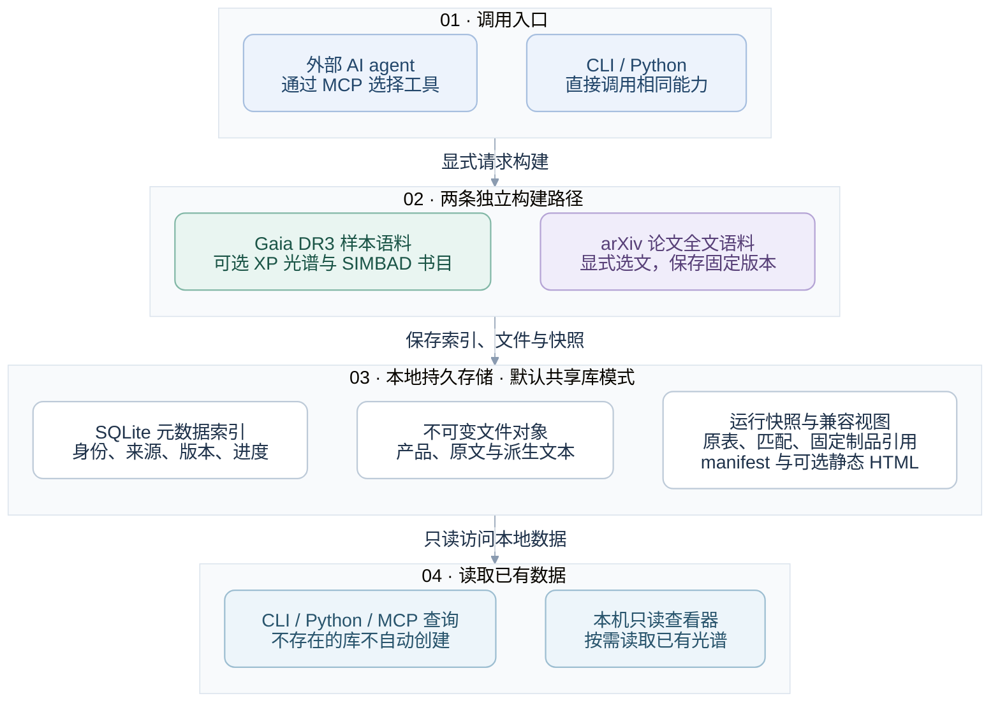
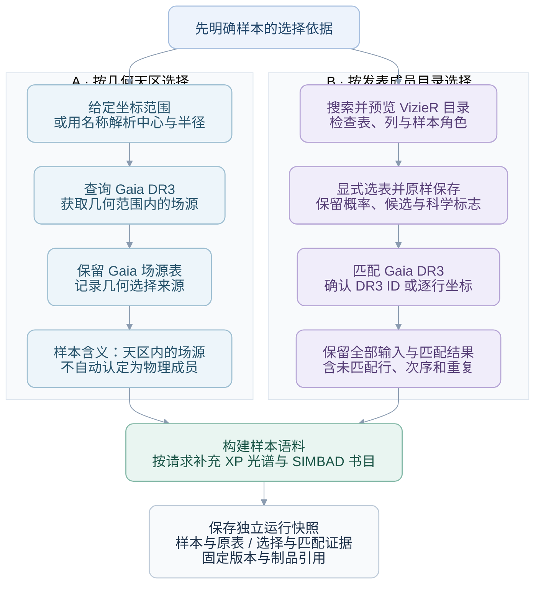
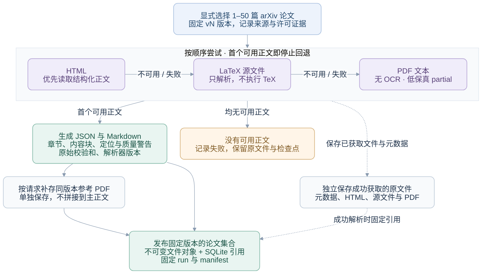

# Architecture and data contracts

## System boundary

The implemented system prepares Gaia DR3 samples, optional XP products and
SIMBAD bibliographies, with an independent, explicitly requested arXiv full-text
workflow. A corpus is a selected sample plus its data and provenance; the shared
library reuses observations without erasing each sample's original rows. The
pipeline does not train a foundation model, perform in-repository language-model
inference, or implement a complete retrieval-augmented question-answering system.

Figure 1 shows the main construction and read paths in **shared-library mode**.
Arrows connect groups of capabilities: either entry point can request either
builder, both builders persist their outputs in the shared library, and readers
access existing local data. The diagram does not impose a build-before-query
sequence. CLI and Python are direct entry points, so an AI agent is optional.
An external agent selects MCP tools; it is not a model embedded in the pipeline.
Read-only queries do not require a build first. Their caller interfaces are named
in the query box.



The SQLite index holds identities, metadata, versions and progress. Immutable
objects hold file bytes; run directories hold sample tables, provenance and exact
artifact references. The optional static corpus HTML is a saved build artifact,
not the separate loopback HTTP library viewer. Viewer requests read local data;
they do not initiate Gaia, SIMBAD or arXiv downloads. Legacy mode, main-table bulk
jobs and generic DataLink requests remain separate supported routes, omitted from
this overview to avoid presenting it as an exhaustive call graph.

<details>
<summary>Figure 1: GitHub-renderable Mermaid source</summary>

<!-- diagram-source:system-overview:start -->

<!-- diagram-source:system-overview:end -->

</details>

The MCP server is a thin adapter. Domain logic remains callable from Python so
other agents and future services are not coupled to one MCP client. A
release-profile and runtime-discovery layer prepares the transport boundary for
DR4 without assuming unpublished schemas or columns. LAMOST and SDSS adapters
are retained but are not the current development focus.

### Edit and regenerate the diagrams

The three `.mmd` files in [diagrams/](diagrams/) are the authoritative editable
sources. Change node labels and directed edges there, rather than editing the
SVG or generated Markdown fence separately:

```bash
# Documentation-only tooling: Python, Node.js/npm and a local Chromium browser.
uv run python scripts/render_diagrams.py

# Re-render one diagram; explicit browser paths are supported on other systems.
uv run python scripts/render_diagrams.py --diagram system-overview \
  --browser /path/to/chrome

# No browser or network: check committed source, SVG and Markdown consistency.
uv run python scripts/render_diagrams.py --check
```

Rendering uses pinned Mermaid CLI 12.0.0 through npm, with a browser already
installed locally. The first tool install may download npm packages; it does not
upload diagram sources, download a browser, or add application runtime dependencies.
`PUPPETEER_EXECUTABLE_PATH` can select the browser. SVG is a scalable display
artifact; structural editing remains in Mermaid. Font/browser differences can
slightly change layout, so byte-identical rendering is not promised. Chinese text
uses installed CJK-capable fonts; no proprietary font files are bundled.

The diagrams use a shared light palette: blue for entry points, green for sample
construction or successful results, violet for paper processing, and gray for
storage. Figure 2 uses blue and violet to distinguish its two selection routes.
Every role is also named explicitly, so colors are not required to read the flow.
Their source hash and renderer version are stamped into each SVG, and the helper
updates the Markdown fences. Re-render and visually inspect after editing;
`--check` alone does not prove that node relationships are correct.

The README's [illustrated overview](images/astro-corpus-hero.png) summarizes source
selection, two independent corpus builds, local storage, and query/view access.
It distinguishes the shared library from per-run snapshots and identifies CLI,
Python and MCP as interfaces to the workflow. The viewer reads existing local
data. The cover was generated with the built-in image generation tool; its
plots, paper pages and viewer illustration are conceptual, not observed data
or an application screenshot. The [design prompts](images/astro-corpus-hero.prompt.md)
are saved for future revisions.

## Input semantics

`resolve_members` normalizes four inputs to canonical Gaia fields:

- `cone`: coordinates plus radius;
- `region`: SIMBAD-resolved center plus radius;
- `name`: one SIMBAD-resolved object;
- `catalog`: user CSV with Gaia DR3 IDs or coordinates.

The first two are geometric field selections. Physical membership is a
separate literature workflow in `membership.py`. Figure 2 shows why the two
routes are not interchangeable: geometry defines a spatial selection, whereas
a published table supplies the scientific membership or candidate definition.
The table's original probability/flag columns are evidence, not an instruction
for this pipeline to silently filter rows.



The figure covers cone/named-region selection and VizieR member tables. A single
source name and an uploaded CSV are additional `resolve_members` inputs, not
automatic association-membership classifiers. Older-release IDs in a chosen
table remain evidence; they must not be relabeled as DR3 IDs. Matching adds its
own outcomes and leaves the selected table unchanged.

<details>
<summary>Figure 2: GitHub-renderable Mermaid source</summary>

<!-- diagram-source:sample-selection:start -->

<!-- diagram-source:sample-selection:end -->

</details>

The fixed CrA and Upper Sco acquisition presets are published-table
selections, not sky regions:

| Preset | Selected table | Full-table rows | Gaia DR3 matching |
|---|---|---:|---|
| CrA | Esplin & Luhman (2022), `J/AJ/163/64/table1` | 393 | The table's Gaia identifiers are EDR3 evidence; match the numeric `RA_ICRS` / `DE_ICRS` coordinates to DR3 |
| Upper Sco | Luhman & Esplin (2020), `J/AJ/160/44/table5` | 1,761 | The table's Gaia identifiers are DR2 evidence; match the numeric `RAJ2000` / `DEJ2000` coordinates to DR3 |

The selected VizieR rows are preserved unchanged. Older-release identifiers
remain source-table evidence and are never reused as bare DR3 identifiers. The
matcher adds no hidden membership-probability, candidate, RUWE, population, or
other quality cut; matched, unmatched, invalid-coordinate, duplicate, and
multiple-candidate outcomes all remain auditable. Here, "full" means all rows in
these two explicitly selected tables, not every star in either sky region or
every historical membership definition.

The coordinate matcher used by both uploaded catalogues and literature tables
queries a union of small Gaia cones in bounded batches and performs
nearest-neighbour assignment locally. It avoids the old single large-cone
failure mode, where a global row limit could truncate candidates before all
coordinates were represented. It also avoids TAP upload jobs that were
observed to remain queued for minutes.

The shared library can satisfy exact release-qualified source-ID lookups, but it
is not a sky-coverage index. Cone, named-region, and coordinate-match selections
still query Gaia; the presence of cached sources cannot prove that a local cone
is complete.

## Canonical members table

Core Gaia columns use the existing names required by corpus and visualization
code:

| Canonical column | Gaia DR3 source |
|---|---|
| `gaia_release` | release-qualified identity component (`dr3` currently) |
| `Gaia` | `source_id` (stored as string) |
| `RAICRS`, `DEICRS` | `ra`, `dec` |
| `Plx_gdr3`, `e_Plx_gdr3` | parallax and error |
| `pmRA_gdr3`, `pmDE_gdr3` | proper motion |
| `Gmag_gdr3`, `BPmag_gdr3`, `RPmag_gdr3` | mean photometry |
| `RV_gdr3`, `RUWE_gdr3` | radial velocity and RUWE |

Quality fields such as BP/RP excess, astrometric excess noise, visibility
periods, good AL observations, and duplicate flag are preserved without an
automatic quality cut.

The global `sources` relation deduplicates reusable attributes by
`(gaia_release, source_id)`. Run-local input and sample-member relations do not:
each original row, match decision, ordinal, and duplicate occurrence remains
available. This separates reusable source identity from the scientific meaning
of a selected sample.

For literature membership corpora, every source-table column is namespaced as
`member_<original_name>`. Provenance columns identify catalogue/table, match
method/radius, angular separation, and candidate multiplicity. This keeps the
published sample definition available to downstream reviewers.

## Simplified JSONL export

`scripts/export_jsonl.py` is an explicit downstream export, not a file that every
corpus build automatically creates. Its `to_record()` function defines the
current simplified schema. **Each JSON line represents one catalog/sample row**;
two input rows resolving to the same Gaia source remain two records. Use
`provenance.input_row_id` and `provenance.run_id` when present to distinguish them.
Unmatched source-table rows remain in their dedicated corpus artifacts rather
than becoming invented Gaia records.

| Field group | Meaning |
|---|---|
| `gaia_release`, `gaia_id` | Release-qualified source identity; IDs remain strings |
| `ra_deg`, `dec_deg`, `parallax_mas`, `parallax_error_mas`, `g_mag`, `pm_ra_masyr`, `pm_dec_masyr` | Available astrometry/photometry with unit-bearing field names; missing values are null |
| `quality` | Retained quality diagnostics and suggested boolean flags; no input filtering or scientific certification |
| `multimodal.gaia_xp.sampled` / `.continuous` | Availability, locally readable/cached state, product location and supported spectrum/coefficients payload |
| `multimodal.lamost`, `multimodal.sdss` | Availability flags from the configured single-corpus lookup, not evidence of a complete cross-survey fusion |
| `papers`, `n_papers` | Bibliographic metadata and its count; not full paper text or paragraph-level evidence |
| `provenance` | Pipeline/release and any retained input-row/run/raw-row provenance; unknown provenance stays null |

Availability and readable cache state are distinct: a flagged available XP
product is not proof that it was successfully downloaded. Suggested quality
booleans are convenience heuristics, not universal science cuts; inspect the
underlying diagnostics and choose criteria appropriate to the analysis. This
export is not a stable training-data specification, and it does not include the
separate paper-fulltext JSON documents. The operational command is documented
in the [TWA bootstrap](operator-runbook.md#twa-demo-bootstrap).

## Corpus directory contract

```text
data/_library/
  index.sqlite3
  objects/sha256/<prefix>/<digest>.<extension>
  staging/

data/<label>/
  manifest.json
  runs/<run_id>/                   # immutable published run snapshot
    manifest.json
    inputs/<csv-sha256>.csv        # uploaded CSV, when applicable
    input_rows.parquet
    input_matches.parquet
    members.csv
    members.parquet
    product_refs.json
    ...
  members.csv                      # active-run compatibility views
  members.parquet
  membership_catalog.csv          # membership workflow only
  membership_catalog.parquet      # membership workflow only
  unmatched_members.csv           # membership workflow only
  catalogs/
    gaia_xp_availability.parquet   # if XP requested
  gaia_xp_sampled/
    product_refs.json
    checkpoint.json
  gaia_xp_continuous/
    product_refs.json
    checkpoint.json
  simbad_refs.checkpoint.json
  simbad_refs.parquet
  paper_edges.parquet
  product_refs.json
  source_paper_viz.html
```

`manifest.json` is atomically replaced after every stage/batch. It records the
input identity, requested products, stage status/counts, artifacts, warnings,
errors, and run history. The same label cannot be reused for a different input.
Gaia source identity is the pair `(gaia_release, source_id)`; `members.*` and
the manifest both record the release, so equal numeric IDs from two releases
cannot share a corpus checkpoint.
The selection identity includes `limit`; uploaded catalogues additionally use
a SHA-256 content fingerprint, so replacing a same-named CSV cannot reuse old
checkpoints silently. Product-specific checkpoints remain the detailed resume
source.

A library-backed build records `current_run_id` for the attempt. Indexed member
snapshots with a `completed` or `partial` pipeline status can be published;
terminal failed runs retain the previous active snapshot. The immutable run
manifest and SQLite prepared-run record are persisted before compatibility views
or `active_run_id` change. Readers resolve `runs/<active_run_id>/`, never a mixture
of mutable top-level files. A late view/index failure leaves an explicitly
prepared, `view_pending` run for recovery rather than relabeling valid committed
data as failed. A manifest with `snapshot_run_id` is already pinned and does not
redirect to a newer run. Publication is not a promise that optional products all
succeeded; inspect stage outcomes.

`product_refs.json` records the complete product contract and exact immutable
`version_id`/blob checksum selected by that run. References can point into the
shared content-addressed store, or a standalone export can copy those pinned
bytes and rewrite the storage descriptor. Version-2 references are
authoritative; missing or corrupt pins do not silently fall back to a newer
library version or an unrelated legacy file.

`paper_edges.parquet` links a Gaia source to a SIMBAD-curated bibliography. It
is not paper-text substring matching. Core columns are `source_id`, `arxiv_id`,
`bibcode`, `title`, `year`, `journal`, `doi`, and `main_id`.

The global literature layer keeps immutable source-reference snapshots,
per-bibcode metadata observations, and DOI-to-arXiv observations in separate
namespaces. Fresh observations are reused across labels. Positive observations
default to a 30-day TTL; explicit negative observations such as zero references
or no arXiv match default to one day. Failures remain retryable and do not
replace the last successful current pointer. A successful refresh replaces the
current snapshot (including removing obsolete edges) while retaining history.

Label-local SIMBAD Parquet/checkpoint files are compatibility projections. They
record requested-source progress, including successful zero-reference sources
and retryable failures, but do not override global TTL or refresh policy and do
not pull edges from unrelated corpora.

## Paper full-text data flow

Explicit selections use `library/paper_corpus.py` independently of the Gaia and
SIMBAD builders. Figure 3 shows the acquisition/parse path when a pinned artifact
cannot simply be reused. A bibliography edge does not automatically start this
workflow. HTML, LaTeX and PDF are alternative main inputs, not three documents
merged into one text.



Solid edges show the main processing path; dashed edges mean that successfully
retrieved raw evidence is retained independently. Only a usable parse publishes
a new successful text version; a failed parse can still leave raw downloads and
retryable checkpoints. The reference PDF is optional and requested by default;
if it cannot be obtained, usable main text is retained with incomplete-acquisition
status. JSON and Markdown remain tied to the raw file actually parsed.

<details>
<summary>Figure 3: GitHub-renderable Mermaid source</summary>

<!-- diagram-source:paper-fulltext:start -->

<!-- diagram-source:paper-fulltext:end -->

</details>

`sources/paper_fulltext.py` validates arXiv identities and retrieves version-pinned
evidence/artifacts; `paper_text.py` performs bounded, local HTML/LaTeX/PDF parsing
in a time-limited subprocess. JSON preserves ordered, typed blocks and source
locators, while Markdown is a deterministic derivative.

Library schema v2 adds `paper_downloads`, `paper_text_versions`,
`paper_text_artifacts`, `paper_text_current` and `paper_inputs`. Existing generic
requests/runs/attempts/leases and SHA-256 blobs are reused, but paper identities
are not forced into numeric Gaia product contracts. Bibliographic bibcode rows
remain unchanged. Exact arXiv work/version and parser/dependency identity govern
text reuse; ordered input records preserve aliases and selection provenance.

Collection checkpoints are under `data/paper_corpora/<label>/runs/<run_id>/`,
with originals and derivatives in the shared object store. Pinned source checksums
and parser versions are recorded in the derived document. Acquisition, usable
text, requested PDF completeness and scientific fidelity are separate concepts;
`partial` is expected for conservative LaTeX/PDF extraction. License evidence is
not an automatic redistribution/training permission. No source-specific evidence
relation is inferred from the existing bibliography edges.

See [paper corpus guide](paper-corpus.md) for schema fields and operational limits.

## Diagram-to-code map

The figures are views of the current implementation, not a proposed science
pipeline or an exhaustive dependency graph. These entry points justify their
main nodes and edges:

| Relationship in the figures | Implementation to inspect |
|---|---|
| CLI/MCP calls the same corpus builder | [`scripts/build_corpus.py`](../scripts/build_corpus.py), [`mcp_server.py`](../src/astro_pipeline/mcp_server.py), [`corpus_builder.py`](../src/astro_pipeline/corpus_builder.py): `build_corpus_snapshot`, `build_corpus_from_members` |
| Geometry and literature membership use different selection paths | [`intake.py`](../src/astro_pipeline/intake.py): `resolve_members`; [`membership.py`](../src/astro_pipeline/membership.py): discovery, preview and `build_membership_corpus` |
| Source bibliographies and optional XP are distinct stages | [`sources/simbad_refs.py`](../src/astro_pipeline/sources/simbad_refs.py), [`corpus_products.py`](../src/astro_pipeline/corpus_products.py) |
| Index, immutable bytes and run publication have separate responsibilities | [`library/store.py`](../src/astro_pipeline/library/store.py): `LibraryStore`; [`library/files.py`](../src/astro_pipeline/library/files.py): `BlobStore`; [`library/build.py`](../src/astro_pipeline/library/build.py): `LibraryRun` |
| Full text is an explicit, independent builder with parse fallback | [`library/paper_corpus.py`](../src/astro_pipeline/library/paper_corpus.py): `build_paper_corpus`, `_acquire_version`; [`sources/paper_fulltext.py`](../src/astro_pipeline/sources/paper_fulltext.py): `ArxivClient`; [`paper_text.py`](../src/astro_pipeline/paper_text.py): format parsers |
| Viewer reads local metadata, pins and spectrum bytes, without fetching upstream data | [`viz/library_viewer.py`](../src/astro_pipeline/viz/library_viewer.py), [`library/overview.py`](../src/astro_pipeline/library/overview.py), [`spectral_adapters.py`](../src/astro_pipeline/spectral_adapters.py) |
| Global lookup is independent of construction | [`library/query.py`](../src/astro_pipeline/library/query.py): `Library`; [`library/__init__.py`](../src/astro_pipeline/library/__init__.py): `get_library(create=False)` |

## Shared-library concurrency and lifecycle

Per-source, per-product, and per-corpus leases carry monotonically increasing
fencing tokens. Remote calls and file preparation happen outside SQLite write
transactions; only short index/publication steps hold a transaction. Lease waits
and SQLite busy waits are bounded, so contention fails explicitly instead of
hanging indefinitely. Database/object commits and corpus compatibility-view
renames assert the current token. Product label reference/checkpoint/artifact
replacements remain inside one short fenced transaction, preventing a lease
check-versus-replace race. Batch leases use one renewal worker for the group.

Read-only library APIs open SQLite in query-only mode and do not create or
migrate an absent database. Write paths initialize the schema on demand. Legacy
import requires matching declared contracts, checksums, and parsed product
identifier evidence before making a product reusable. Unsupported or conflicting
payloads remain inventory-only, and original legacy selection provenance is not
invented. The system retains historical runs, observations,
product versions, and immutable objects; it has no automatic pruning or garbage
collection. Verification may report orphan/staging files but never deletes
them.

Detailed configuration, administration, import/export, and backup procedures are
in [library.md](library.md).

## XP products and visualization

Gaia availability is queried anonymously from `gaiadr3.gaia_source`. DataLink
downloads are opt-in and can use configured credentials. Sampled and Continuous
products have separate checkpoints and pinned reference documents. Their bytes
are published as immutable shared objects and reused by release-qualified
product identity; a standalone export materializes copies. The builder treats
DataLink failure as an optional-product warning, leaving members and paper data
usable.

Per-corpus static visualization is an explicit build policy:

- `embedded` generates `source_paper_viz.html` and embeds parsed cached spectrum
  arrays. This remains the compatibility default.
- `status_only` generates the same overview but records a cached product as
  available without parsing or embedding its arrays. The page directs the user
  to open that source in the full-library viewer. The fixed CrA/Upper Sco runner
  uses this mode by default.
- `off` does not generate a new static overview.

For `embedded` mode, DR3 XP Continuous is preferred and Sampled is the fallback.
Continuous coefficients are calibrated by `gaiaxpy`; current readers expose one
combined XP series rather than inventing separate BP and RP observations.
ECharts is inlined when the package asset `viz/vendor/echarts.min.js` exists;
otherwise the manifest records that the static HTML requires a sibling script.

The full-library viewer is a separate loopback-only, read-only service launched
with `scripts/library.py serve`. Source and sky pages are revision-pinned and
keyset-paginated from the global index. Spectrum floating-point arrays are read
only after a source is selected. Global scope resolves the current active
product; corpus/run scope resolves the exact version-2 pin, and neither scope
silently falls back to the other. Object integrity and an exact
`(release, retrieval_type)` parser registration are checked before display.

## Release profiles and Archive discovery

`gaia_releases.py` contains stable DR3 facts and deliberately provisional DR4
expectations. DR4 has no static TAP schema in the profile. `gaia_archive.py`
queries `TAP_SCHEMA.schemas`, `TAP_SCHEMA.tables`, and `TAP_SCHEMA.columns` at
runtime; discovered metadata takes precedence over local expectations.

Spectrum dispatch is also release-qualified. The executable registry currently
contains only exact DR3 `XP_CONTINUOUS` and `XP_SAMPLED` FITS contracts. Expected
DR4 names such as `MEAN_SPECTRUM_XP` and `EPOCH_SPECTRUM_XP` are capability hints,
not aliases for DR3 parsers; they remain unsupported until source-specific live
links, serialization, units, time axes, quality fields, and real fixtures are
confirmed.

DataLink requests use an explicit contract:

```text
(release, retrieval_type, identifiers, linking_parameter,
 data_structure, output_format, valid_data)
```

`gaia_products.py` persists that contract, a source checkpoint, artifact
metadata/checksums, Archive table copies, and normalized per-identifier files.
Astroquery returns parsed Astropy tables, so `archive_tables/` is correctly
described as re-serialized table content rather than byte-identical HTTP
payload. Binary image/blob transport remains a separate adapter; in particular
`CROWDED_FIELD_IMAGE` is refused until the public DR4 service can be tested.

## Gaia main-table bulk dataset

Gaia DR3 `source_id` stores the level-12 nested HEALPix in its most significant
bits. At HEALPix level `L`:

```text
divisor = 2^35 × 4^(12-L)
pixel   = floor(source_id / divisor)
```

Thus pixel `p` is exactly the half-open source-ID interval
`[p × divisor, (p+1) × divisor)`. `bulk_gaia.py` creates immutable plans and
downloads each interval with ordered keyset pages. Every page is atomically
written as Parquet, then its checkpoint advances. A failed page resumes from
the last committed source ID. Global progress increments only after a whole
HEALPix chunk completes.

This design can eventually materialize all rows and columns of
`gaiadr3.gaia_source`, subject to storage/time/service policy. It explicitly
does not include Gaia auxiliary tables or DataLink products. Those require
additional product-specific planners.

The bulk plan schema is now release/table-aware, but only DR3 currently has a
confirmed `source_id_healpix12` partition strategy. Supplying an assumed DR4
schema does not bypass this safety boundary.

## Safety boundaries

- MCP never exposes arbitrary ADQL; `execute_adql` is an internal read-only
  primitive used by validated planners.
- IDs, column names, table names, labels, ranges, page sizes, and HEALPix levels
  are validated before query construction.
- Bulk planning downloads no rows; running defaults to one chunk.
- Outputs are atomic where they represent progress state or a complete page.
- Global source/product identity deduplicates reusable state without deleting
  duplicate input rows or membership provenance.
- Read-only library queries never initialize or migrate an absent SQLite file;
  legacy import is dry-run by default and explicit apply never mutates its source.
- Product reference views pin exact versions; shared-reference and standalone
  exports have different, explicit storage contracts. Use `--run-id` for a
  reproducible export and do not export a mutable label tree during a build.
- Credentials are loaded from gitignored local configuration and never placed
  in manifests. Library databases, objects, and generated corpus data are also
  excluded from Git.
- Network retries use bounded exponential backoff for transport failures and
  HTTP 408/429/5xx from both `httpx` and astroquery's `requests` stack;
  permanent authentication/query 4xx errors are not retried blindly.
