# 技术栈、系统架构与 MCP 使用边界

> 核对日期：2026-10-13。本文面向有 Python / 天文数据处理基础、希望理解软件工程架构的读者。
> 描述的是当前工作区的实现，不意味着所有内容已经发布到 GitHub 的默认分支。
> 安装和客户端配置以 [MCP integration guide](integration-guide.md) 为准；
> 精确数据契约见 [architecture](architecture.md)，存储操作见 [library](library.md)。

## 1. 项目是什么，不是什么

当前项目是一套 **Python 天文数据管线 + 共享数据存储 + MCP 工具接口 + 只读网页查看器**。
它不是大模型，也不是只能通过 AI 才能运行的程序。

- AI agent 在管线外部：理解自然语言、选择工具、填写参数、解释返回结果。
- Python 核心负责执行：查询、交叉匹配、产品获取、标准化、校验、保存和导出。
- MCP 让不同 agent 客户端调用这些现成能力；不用 MCP，也能通过 CLI 或 Python 函数调用。
- 网页用于查看本地已有数据，不因为点击某颗星就偷偷访问 Gaia 下载光谱。

工程上，它更接近一个**模块化单体应用**：主要业务在同一个 Python 项目中按职责拆分，
不是由许多独立部署的微服务组成。MCP 与查看器可以是不同进程，但共享代码和本地存储。

当前科学主线是 Gaia DR3 + 源—文献关联 + Gaia XP。2026-10-08 增加了显式的 arXiv
全文获取与保守结构化处理：原文件、JSON、Markdown 和版本/质量记录独立保存，详见
[论文语料说明](paper-corpus.md)。本项目不负责训练基础模型，尚未实现 embedding 或 RAG 系统。

## 2. 整体架构



图 1 与 [架构说明](architecture.md#system-boundary) 使用同一份
[Mermaid 源图](diagrams/system-overview.mmd)，不是另一套需要单独维护的流程。
入口到构建的箭头表示调用，构建到存储的箭头表示保存，存储到查询/查看器的箭头表示读取
已有数据。图不是所有函数的时序图，也不要求先构建才能执行只读查询。

星表样本构建和论文全文构建是独立入口：SIMBAD 书目关联不会自动触发全文下载。
SQLite 管理元数据，文件对象保存实际字节，运行快照固定样本定义和制品引用。
静态 corpus HTML 是构建产物；本机 HTTP 查看器则是读已有数据的独立服务。

[样本选择图](architecture.md#input-semantics)进一步区分几何场源和发表成员表，
[全文流程图](architecture.md#paper-full-text-data-flow)说明格式回退和原文/派生文本的关系。
节点和连线可改 `.mmd` 源，SVG 由本地工具重新导出；方法见架构说明的编辑章节。

三个边界尤其重要：

1. **入口不等于算法。** MCP、CLI 和 Python API 可以调用相同的核心业务函数。
2. **查看不等于采集。** HTTP 查看器只读已有科学数据，可按需解析或缓存派生绘图结果。
3. **共享不等于联网。** 当前“共享 library”首先指本机不同 corpus / run 复用数据，
   不表示已经提供多用户远程服务。

## 3. 当前技术栈

| 层次 | 技术 | 在项目里的作用 |
|---|---|---|
| 主语言 | Python ≥ 3.11 | 数据获取、匹配、处理、存储与接口 |
| 环境与依赖 | uv、pyproject.toml、uv.lock | 管理 Python 环境、依赖范围和解析后的版本 |
| 表格与天文处理 | pandas、Astropy | 表格操作、坐标、单位、FITS 等 |
| 外部服务访问 | astroquery、HTTPX、requests | 访问 Gaia、VizieR、SIMBAD、arXiv 等服务 |
| 配置与验证 | Pydantic、PyYAML | 验证配置结构，读取默认值和本地覆盖 |
| Gaia 光谱处理 | GaiaXPy | 将 XP Continuous 系数重建为校准光谱 |
| 本地数据库 | SQLite | 管理源、样本关系、产品版本、文献与运行状态 |
| 文件存储 | FITS、Parquet、JSON 等 | 保存光谱、表格、清单和引用 |
| Agent 接口 | MCP Python SDK 中的 FastMCP | 把 Python 能力暴露为结构化工具 |
| 网页后端 | Python ThreadingHTTPServer | 提供仅监听本机的只读网页和数据 API |
| 网页前端 | 原生 HTML/CSS/JavaScript、ECharts | 页面布局、交互、天球图与光谱图 |
| 静态光谱图 | Matplotlib | 为相应接口生成 PNG，不是浏览器交互图的引擎 |
| 测试 | pytest、Playwright | 测试数据逻辑、异常恢复和真实浏览器行为 |
| 打包 | Hatchling、wheel | 将 Python 代码和网页资源打成可安装包 |

运行依赖声明在 [pyproject.toml](../pyproject.toml)。Playwright 用于可选浏览器测试，
不要求普通 MCP 使用者安装完整前端开发工具链。当前查看器不是 React / Vue 应用，
也没有依赖 Node.js 才能运行的前端构建流程。

### 3.1 uv、Git 和 run 管理不同的版本

```text
pyproject.toml：项目允许的依赖范围
uv.lock：依赖解析后选定的具体版本
.venv：本机实际安装、运行这些包的环境
Git：程序与文档的修改历史
run 快照：某一次数据构建的输入、参数、结果和来源
```

`uv.lock` 不独自证明任意激活环境中的实际安装版本。使用 `uv sync --locked` 和
`uv run --locked ...`，可以按照锁文件准备和使用项目环境。

代码版本固定不等于数据结果固定。远端目录、论文关联或产品可以更新；要复现一次分析，
还需要记录科学选择、数据版本和处理过程。生成的数据、个人配置与凭据不随 Git 分发。

### 3.2 配置不是只有一层

管线的默认设置来自 [config/default.yaml](../config/default.yaml)，
个人覆盖放在被 Git 忽略的 `config/local.yaml`。共享库路径还可以通过
`ASTRO_PIPELINE_LIBRARY_DIR` 覆盖；Gaia 凭据可由 `GAIA_USERNAME` / `GAIA_PASSWORD` 提供。

这些是**管线运行配置**，不同于 `.mcp.json` 这样的**客户端启动配置**。前者决定程序
如何保存数据和访问服务，后者告诉 agent 客户端如何启动程序。

## 4. Python API、CLI、MCP 与 HTTP

### 4.1 Python 函数是真正执行工作的地方

例如 [membership.py](../src/astro_pipeline/membership.py) 中的
`build_membership_corpus()` 是公开的成员构建入口。Python 脚本可以直接调用它，
不需要自然语言模型、MCP 或浏览器。

CLI 是将终端参数转交给这些函数的入口，例如 `scripts/build_corpus.py` 和
`scripts/collect_regions.py`。核心逻辑不应在每个入口各复制一套。

### 4.2 MCP 是工具调用协议，不是大模型

MCP 描述工具名称、参数、结果及调用方式。Agent 可以根据用户要求选择工具；参数传入后，
Python 程序按明确规则执行。MCP 工具并不默认获得任意 SQL 或任意代码执行入口。

当前 [mcp_server.py](../src/astro_pipeline/mcp_server.py) 使用 FastMCP，
通过 `mcp.run()` 的默认 **stdio** 方式启动：客户端运行一个本地 Python 子进程，
双方通过标准输入、标准输出交换协议消息。因此，直接在终端启动 server 后等待输入，
不是浏览器网页，也不等于启动了一个可远程连接的端口。

如果类比 agent 的其他组成部分：Skill 更像操作说明，MCP 是可调用的工具接口，
Python 业务模块才是工具真正执行的算法和数据处理。

### 4.3 HTTP 查看器是另一个服务

```text
浏览器请求 /api/v1/sources
        ↓
Python 查看器查询本地 SQLite
        ↓
返回 JSON
        ↓
浏览器更新表格和图
```

当前查看器仅监听 `127.0.0.1`，默认端口 8765。它不是 MCP endpoint，也没有下载或写库 API。

| 通信 | 用途 |
|---|---|
| Agent ↔ MCP 程序 | 工具调用，既有只读工具，也有显式采集工具 |
| 浏览器 ↔ 本地 HTTP 查看器 | 查看已有数据与本地光谱 |
| Python ↔ Gaia/VizieR 等 | 通过 HTTP 等服务接口获取远程数据 |

API 是“应用程序接口”的泛称；Python 函数、HTTP API 与 MCP 工具是不同形式的接口，
不应把 API 一律理解为一个公网网址。

## 5. 一次成员语料构建如何执行

### 5.1 先定义科学样本

成员目录使用固定顺序：

```text
search_membership_catalogs
    → preview_membership_catalog
    → 明确选择 catalog_id / table_id
    → download_membership_corpus
```

不同论文或同一目录中的不同表可能表示已采纳成员、候选成员、被排除对象或混合样本。
程序负责保存并执行选择，不把搜索排名当成科学权威，也不自动隐藏概率、RUWE、群体或候选标志。

`cone` 和 `region` 是几何场源选择。即使 `region` 的名字是一个星团，也不自动获得
物理成员资格。选定 VizieR 原表始终保留；原表行数、匹配行数和独立 Gaia 源数是不同统计量。

### 5.2 逐行匹配到 Gaia

有明确 Gaia DR3 ID 的输入可按 ID 匹配；否则使用受支持的坐标列匹配。
不同 release 的 ID 不可不加判断地互用。

例如 CrA 固定采集采用 `J/AJ/163/64/table1`，保留原 EDR3 标识作为来源证据，
以选定数值坐标匹配 DR3。Upper Sco 的固定表 `J/AJ/160/44/table5` 同样保留原 DR2
标识，再进行 DR3 坐标匹配。两套任务均使用固定 3 arcsec 半径，没有静默扩大半径或应用
成员概率阈值，也没有实施自行历元传播。J2000 equinox 不能替代未知的坐标观测历元。

程序同时保存：

- 每个原始输入行及其 ordinal；
- 匹配方法、分离角和候选数量；
- 未匹配行与匹配失败原因；
- 多个输入行匹配到同一颗星的情况；
- 原始文献列以及标准化成员表中的 `member_` 列。

采集成功不等于每个科学匹配都已经独立验证。

### 5.3 获取 Gaia 基本信息

三个术语的区别：

- **TAP**：访问远程表格查询服务的协议。
- **ADQL**：提交给天文数据库的查询语言，类似 SQL，增加天球几何等能力。
- **astroquery**：帮助 Python 使用这些服务的客户端库。

本地 SQL 问“我的库里有什么”，远程 ADQL 问“Gaia Archive 里有什么”。
本地 library 不是全天空索引，不能用不完整缓存代替新的 cone、region 或坐标选择。
显式复用已发布、校验通过的 frozen selection 是另一种受约束的恢复操作，不是默认猜测。

### 5.4 补充观测产品与文献

光谱路线：检查可用性 → 按用户显式选项请求 DataLink 产品 → 校验身份与文件 → 保存状态。
XP Sampled / Continuous 默认均不下载；可用性标志也不等于已经下载并验证。

文献路线：SIMBAD 源—论文关联 → 标题、年份、DOI 等元数据 → DOI 对应的 arXiv 标识。
源—论文关联不等于下载了论文全文，也不等于模型已经阅读论文。

DOI→arXiv 查询区分成功匹配、成功无匹配、失败和延期。传输错误或歧义不能写成
“确定没有 arXiv”。同 DOI 多结果只按唯一的精确规范化标题证据消歧，保留查询依据。

### 5.5 完成、固定并发布结果

默认共享库模式下，主要调用关系简化为：

```text
MCP download_membership_corpus
    ↓
membership.build_membership_corpus()
    ↓
membership._build_indexed_membership()
    ↓
corpus_builder.build_corpus_from_members()
    ↓
LibraryRun.finish()
```

`LibraryRun` 管理一次构建的生命周期；选表和匹配阶段已经有运行记录，不是到最后才登记。
已完成成果可以保留并复用；可选产品暂时失败时，不应丢弃已经成功的基础语料。
发布状态与全部阶段完成状态必须分开检查，不能把“已经启动”“已有缓存”或“已发布部分结果”
说成全量完成。

## 6. 数据模型：source、corpus、run、product、blob

| 对象 | 含义 |
|---|---|
| source | 某个 Gaia release 标识的天体源，身份为 `(release, source_id)` |
| corpus | 一个有标签、输入定义和保存位置的数据集，可包含多次运行 |
| run | 对某个 corpus 进行的一次具体构建，记录参数、状态、错误和产物 |
| product | 明确请求契约与标识符对应的数据产品，可以有多个不可变版本 |
| blob | 实际文件字节，以 SHA-256 等校验信息标识，由产品版本引用 |

正式结构见 [library/schema.py](../src/astro_pipeline/library/schema.py)。
产品身份不仅是文件名，还包括 release、产品请求契约、标识符及相关规范化版本。

### 6.1 源身份不是单独的 source_id

```text
源身份 = (release, source_id)
```

DR3 与 DR4 的源列表独立，不能假设同数字 ID 就是跨 release 同一对象。
ID 在接口中作为字符串保存和传递，避免 JavaScript 普通数值类型无法精确表示所有 19 位整数。

### 6.2 全局去重不删除样本行

假设一颗星 A 出现在两个样本中，且在第二个样本里出现两次：

```text
全局源：A

样本关系：
    样本甲，第 7 行  → A
    样本乙，第 12 行 → A
    样本乙，第 19 行 → A
```

A 不必在全局源表登记三份，相同光谱也不必下载三份，但三条输入记录必须全部保留。
去重的是可共享数据，不是科学来源或输入样本的多重出现。

### 6.3 schema 与 provenance

**Schema（数据结构约定）**回答：有哪些字段、类型、单位、主键、关系和缺失值语义。
例如源 ID 是字符串、坐标单位是度、release 是身份的一部分。

**Provenance（来源与处理依据）**回答：这条记录来自哪张表、哪一行、哪次查询、什么匹配规则，
经过哪些变换，又被哪个 run 使用。

CSV/Parquet/JSONL 文件后缀相同不意味着 schema 相同。SQLite 是内部存储实现，
不是要求所有下游都直接接收数据库文件；下游交付仍需约定字段、版本、单位、选择函数和许可。

## 7. SQLite、文件对象与快照怎样配合

```text
SQLite：结构化字段、对象关系、状态、版本指针
文件对象：实际产品文件
运行快照：某次构建固定的输入、输出、匹配和引用
```

默认目录结构概念上如下，具体文件随所请求阶段而变化：

```text
data/
├── _library/
│   ├── index.sqlite3
│   └── objects/
│       └── sha256/...          不可变产品文件
└── 某个样本标签/
    ├── manifest.json          当前构建与发布状态
    ├── members.parquet        当前兼容视图
    └── runs/
        └── 某次 run_id/
            ├── manifest.json
            ├── members.parquet
            ├── ...            输入、匹配、文献等阶段产物
            └── product_refs.json
```

SQLite 不需要单独启动数据库服务器；Python 通过本地数据库文件访问它。
它可以保存数组，但本项目没有选择把所有光谱大数组塞进数据库，而是用文件对象便于共享、校验和导出。

### 7.1 内容寻址存储

Blob 文件按内容哈希组织，称为 content-addressed storage。产品与 run 通过引用找到文件，
而不是为每个样本复制相同字节。读取时校验哈希可发现丢失或损坏。

**哈希一致只能证明字节一致，不能证明匹配到了正确科学对象。** 产品身份仍需单独验证。
通过 Archive 客户端读取后再序列化的表，也不能冒充 byte-identical 的原始 HTTP 响应。

### 7.2 当前结果与历史结果

全局当前指针方便日常查询；不可变 run 固定过去某次构建结果。
版本 2 `product_refs.json` 固定精确产品版本，不是“以后随便拿最新产品”的提示。
选定 run 缺少某个产品时，不应偷偷回退到全局当前版本。

- `current_run_id` 表示当前尝试。
- `active_run_id` 选择 corpus 根目录发布的运行，但不独自证明所有请求阶段成功。
- `snapshot_run_id` 固定特定运行或导出。

Manifest 是描述输入、阶段状态、产物与引用的清单，不是科学星表本身。
可靠地判断一次任务完成，需要结合运行终态、阶段错误和产物验证。

### 7.3 数据格式分工

| 格式或对象 | 主要作用 |
|---|---|
| pandas DataFrame | Python 内存中的表格，不是磁盘格式 |
| Parquet | 带类型的列式表格文件，适合存储和分析 |
| FITS | 天文数组、表及其元数据 |
| JSON | API 响应、manifest 和产品引用等结构 |
| JSONL | 一行一条 JSON 记录，适合逐条导出和处理 |
| SQLite | 支持查询、事务和关系维护的数据库 |

这些工具并不互相排斥。“语料格式通用”取决于下游能否理解 schema 和语义，
不是只要统一文件后缀就能完成。

## 8. 可靠性机制各解决什么问题

### 8.1 缓存：已有结果能否复用

必须区分成功有数据、成功明确无数据、查询失败而未知三种状态。
超时不等于没有数据；失败刷新不能抹掉上次成功结果。

默认新鲜正结果有效期为 30 天，明确负结果为 1 天。时效缓存决定是否重用查询结果，
不可变 run 则固定历史依据，两者不是同一概念。`refresh=True` 可以更新当前结果，但保留历史。

### 8.2 Checkpoint：中断后从哪里继续

如果 1,000 个产品处理到第 600 个中断，checkpoint 记录已完成、失败和待处理的单位，
后续可复用已有成果。这里主要指按源、产品或阶段恢复，不保证每个 HTTP 文件都支持字节级续传。

### 8.3 幂等：重复执行不会越做越乱

同一产品重复请求，不应制造无意义且无法区分的副本。
数据可以复用，新的构建仍可创建新 run，保存本次请求和处理历史。

### 8.4 事务与原子文件写入：不让读者看到半成品

SQLite 事务让一组数据库修改一起提交或回滚。文件则先准备临时文件、刷新到磁盘，
再通过原子替换发布，避免读者看到写了一半的内容。

数据库事务不能自动涵盖所有网络和文件操作。当前设计把网络、解析和文件准备放在写事务外，
最终登记在短事务中完成。SQLite 使用 WAL 支持读写并存，但同一时刻仍只有一个写事务，
不是可以无限并行写入的分布式数据库。

### 8.5 Lease 与 fencing：旧进程不能覆盖新进程

Lease 是有有效期的工作许可，fencing token 是递增编号：

1. 进程 A 拿到某项工作的编号 17。
2. A 长时间停顿，许可过期。
3. 进程 B 接管，拿到编号 18。
4. A 恢复后，不能用旧编号覆盖 B 的结果。

网络或文件准备完成后，最终 metadata 更新仍要在事务中验证有效 owner/token。
这些机制不是完整任务队列，也不自动提供远程多用户身份、授权、配额或审计。

## 9. 网页与光谱：Python 计算，浏览器展示

### 9.1 Python 后端

点击某个源后，后端按需执行：

1. 确定 global-current 或 corpus/run-pinned scope。
2. 选择精确 `(release, retrieval_type)` 对应的适配器。
3. 验证产品文件和标识。
4. 读取或校准光谱。
5. 返回等长、可 JSON 序列化的波长、通量、误差及来源信息。

XP Sampled 已包含采样数组，主要通过 Astropy 读取；XP Continuous 主要保存基函数系数，
需要 GaiaXPy 重建校准光谱，不能把系数直接当作波长—通量曲线。

当前支持 DR3 `XP_SAMPLED` / `XP_CONTINUOUS`。校准后合并谱明确标为 `XP combined`，
不按波长人为拆成两条“独立 BP/RP 观测”。未支持或损坏的数据给出对应状态，不虚构曲线。

### 9.2 浏览器前端

- HTML 定义元素；CSS 定义外观。
- JavaScript 管理筛选、选择、请求、刷新和过期响应。
- ECharts 绘制天球图、光谱、坐标轴和 tooltip。
- 浏览器不运行 GaiaXPy、不解析 FITS、不触发远程产品下载。

MCP 的静态 PNG 另可由 Matplotlib 生成，与 ECharts 交互图是两条展示路径。

### 9.3 全库同步与一致性

查看器约每 5 秒检查本地库变化，目录和天球图逐页获取，不能只画前 500 个源却显示“全部”。
分页携带 revision；库变化时拒绝混合不同版本的分页，并进行有限次重新获取。

这是读取一致性问题，不是天文算法问题。当前数据接口使用批量 SQL，避免逐源重复查询。

天球图采用 Hammer–Aitoff 等面积投影，RA 向左增加。无有效坐标的源保留在目录和计数中，
不伪画在 `(0, 0)`。光谱的小通量采用明确指数缩放，展示缩放不改变物理数组。

## 10. MCP 是项目级还是用户级

**作用域属于客户端的注册配置，不是 Python server 固有的科学能力。**

当前仓库提供：

- 根目录 [.mcp.json](../.mcp.json)：Claude Code 等兼容客户端的项目级启动配置。
- [.codex/config.toml](../.codex/config.toml)：Codex 的项目级配置。

以 Claude Code 为例：

| 作用域 | 对谁、在哪里生效 | 是否由本仓库分发 |
|---|---|---|
| local | 当前用户、当前项目的个人配置 | 否 |
| project | 当前项目；每位使用者仍须信任/批准 | 是，`.mcp.json` |
| user | 当前用户在不同项目中的会话 | 否，属于个人配置 |

这里确认的是仓库提供的配置，不能据此排除某台机器还注册了同名个人配置。
可用 `claude mcp get astro-corpus` 查看实际配置来源，进入会话后用 `/mcp` 检查连接。
用户级不等于系统所有用户可用，也不等于已开放到公网。

### 10.1 自己使用

最简单的方式是在安装好依赖后，从仓库根目录启动 Claude Code，批准项目 MCP。
不必先手动启动另一个长期运行的 stdio server；客户端负责启动所配置的进程。

如果希望在别的工作目录也能调用同一份程序，可做用户级注册，并用绝对路径指定仓库工作目录。
完整命令见 [integration guide](integration-guide.md#claude-code-scopes-and-personal-reuse)。
`uv --directory` 不仅选择环境，还将程序工作目录固定到仓库，避免 `data/` 和 `config/`
随调用者当前项目漂移。单独指定解释器或 `--project` 不能代替这项工作目录约束。

### 10.2 别人使用

必须区分三种分享：

| 目标 | 方式 | 数据在哪里 |
|---|---|---|
| 使用同样的采集能力 | clone 代码、安装依赖、本地注册 MCP | 默认在对方电脑 |
| 查看或复现某个固定数据集 | 另行提供经许可的固定 run 导出 | 对方导出的本地副本 |
| 所有人持续更新同一主库 | 部署有认证、授权和任务控制的远程 MCP | 统一服务器 |

第一种现在就能使用。第二种可使用现有 immutable-run export，独立产品副本采用
`--standalone`，详见 [library](library.md)。第三种尚未完成服务器化，不能靠把
`.mcp.json` 放进 GitHub 或把网页 8765 端口暴露出去自动获得。

其他 MCP 客户端有自己的配置约定，并非都自动读取 `.mcp.json`。本地模式要求客户端能启动
stdio 子进程；只支持远程 URL 的云端连接器不能直接使用这个本地命令。

## 11. GitHub 能分享什么

**可以通过 GitHub 分享代码和便携配置；GitHub 本身不会托管正在运行的 MCP 进程或共享 SQLite。**

- 代码分发：仓库源码、依赖锁文件、文档、测试、无秘密的项目 MCP 配置。
- 数据分发：另行选择固定 run 的导出、产品和许可；不是默认提交整个 `data/`。
- 在线服务：需要实际服务器和远程接入能力；GitHub Pages 只能提供静态内容，不能运行这里的
  Python MCP / SQLite 写入服务。

公开前应检查：

1. 有权公开项目代码，并明确源码许可证；公开可读不等于自动授予开源使用权。
2. 保留第三方依赖和 vendored 资源所要求的许可声明；代码许可不能代替上游数据使用条款。
3. 不提交 `config/local.yaml`、环境文件、账号密码、token、私人日志和个人客户端配置。
4. 不提交 SQLite/WAL、对象库、FITS/Parquet 等生成数据。默认 `data/` 被忽略，
   自定义库路径仍需单独确认；`.gitignore` 不会移除已跟踪文件或清理过去的 Git 历史。
5. 检查绝对路径、个人信息和旧提交中的敏感内容；本说明不是已经完成的全历史安全审计。
6. 在干净环境验证 clone、依赖安装、离线测试及无 demo 数据的 MCP 启动行为。
7. 确认要发布的分支/提交确实包含所需功能；未提交的本地文件不会出现在别人 clone 的仓库中。

截至本文核对日期，仓库根目录未发现项目级 LICENSE / COPYING / NOTICE 文件。
选择许可证是项目维护者的决定，本文不代为添加。私有协作仓库可先向指定协作者授权，
不必为了让他人使用代码就立即改为公开仓库。

## 12. 当前边界与未来部署

当前已具备：Gaia DR3 获取与成员目录流程、共享缓存与版本记录、可恢复采集、运行快照、
本地 MCP、只读全库查看器，以及 DR4 的能力探测和安全适配边界。

当前不应声称：

- 已确认或启用了真实 DR4 光谱解析、普通 DR4 corpus normalization 或未确认的 bulk 分区规则；
- LAMOST/SDSS 已与 Gaia XP 一样接入全套共享产品版本、run pin 和网页解析体系；
- 已有覆盖所有出版社、OCR、复杂公式/表格的完整全文处理，或向量检索、RAG、模型训练系统；
  当前只有 arXiv 来源的显式、有界获取与带质量警告的本地解析；
- 已有远程 MCP 认证、用户授权、下载配额和持久任务队列；
- 复制一个 SQLite 文件就完成了整库跨路径迁移。

Windows + WSL2、私网接入和远程 HTTP MCP 属于可行的后续部署方向，不是现成组件。
SQLite 文件本身跨平台，但持久路径和 corpus 身份仍有迁移约束；现有 standalone export
固定一个运行，不等于迁移所有全局历史。活库备份须用 `LibraryStore.backup()`，并一并管理
对象文件和所需快照，不能直接复制正在写入的 `index.sqlite3` 作为完整备份。

多用户共同写库时，写入者应留在服务器本地，通过受控接口操作；不让客户端挂载 SMB、同步盘
并直接打开同一个活 SQLite。远程结果中的本地路径和 `file://` 也需要改成受控 artifact 访问。

## 13. 测试、阅读入口与理解标准

### 13.1 测试能证明什么

- pytest 离线测试：验证科学/工程不变量、错误处理、缓存、身份、快照和恢复。
- 网络测试：检查真实上游服务的协议、列和当前可用性，默认不运行。
- Playwright：在实际浏览器里验证筛选、分页、图、刷新和错误状态。
- 安装包 smoke：验证代码和资源不仅在源码目录可用，也能从 wheel 正常加载。

```bash
uv run --locked pytest -q
```

离线测试通过不代表 Gaia 此刻在线；文件下载完成不代表科学匹配已全部人工确认。
测试数量随开发变化，具体执行记录见当次验证结果，不把较早学习指南的基线当成当前状态。

### 13.2 按问题阅读，而非从头逐行读完

| 要理解的问题 | 主要入口 |
|---|---|
| 请求如何成为成员语料 | [membership.py](../src/astro_pipeline/membership.py)：`build_membership_corpus` |
| 通用构建后半段做什么 | [corpus_builder.py](../src/astro_pipeline/corpus_builder.py)：`build_corpus_from_members` |
| 对象之间有什么关系 | [library/schema.py](../src/astro_pipeline/library/schema.py) |
| 数据库怎样读写与协调 | [library/store.py](../src/astro_pipeline/library/store.py)：`LibraryStore` |
| 一次运行怎样固定并发布 | [library/build.py](../src/astro_pipeline/library/build.py)：`LibraryRun` |
| 光谱怎样选版本和解析 | [spectral_adapters.py](../src/astro_pipeline/spectral_adapters.py)、[spectra.py](../src/astro_pipeline/spectra.py) |
| Agent 怎样调用这些能力 | [mcp_server.py](../src/astro_pipeline/mcp_server.py) |
| 网页怎样读库 | [library/overview.py](../src/astro_pipeline/library/overview.py)、[library_viewer.py](../src/astro_pipeline/viz/library_viewer.py) |

[learning guide](learning-guide.md) 适合补模块、类、调用链、契约和 pytest 基础。
[operator runbook](operator-runbook.md) 负责实际运行和故障恢复说明。

“了解足够”的标准不是背依赖包名，而是能分清科学样本定义、数据获取、存储管理和展示各自
负责什么。例如选错成员表不是网页问题，光谱轴缩放错误不一定是下载问题，而跨 release 的
ID 混淆属于身份模型问题。理解这些边界，才能判断功能改动应该放在哪一层、验证哪些不变量。
